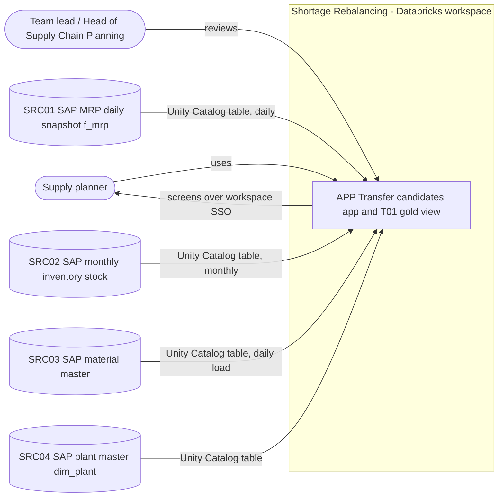
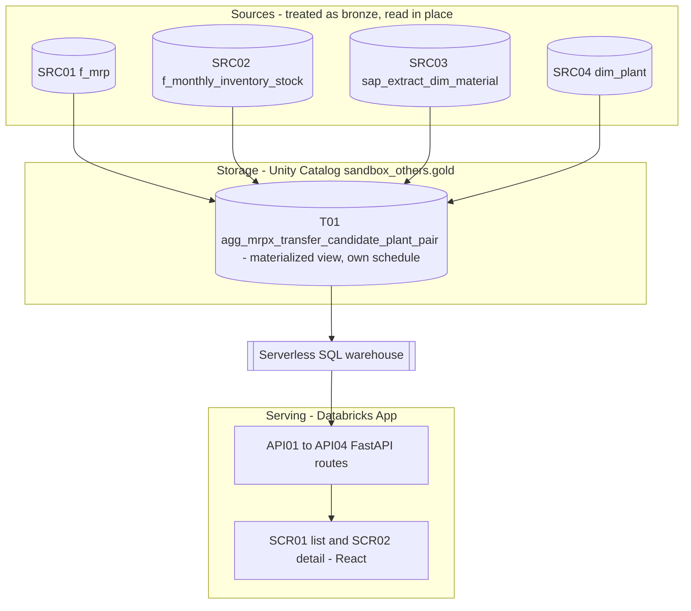
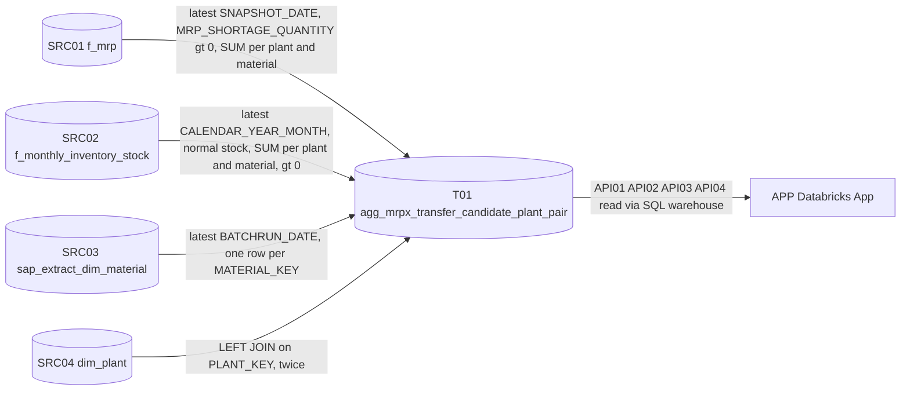
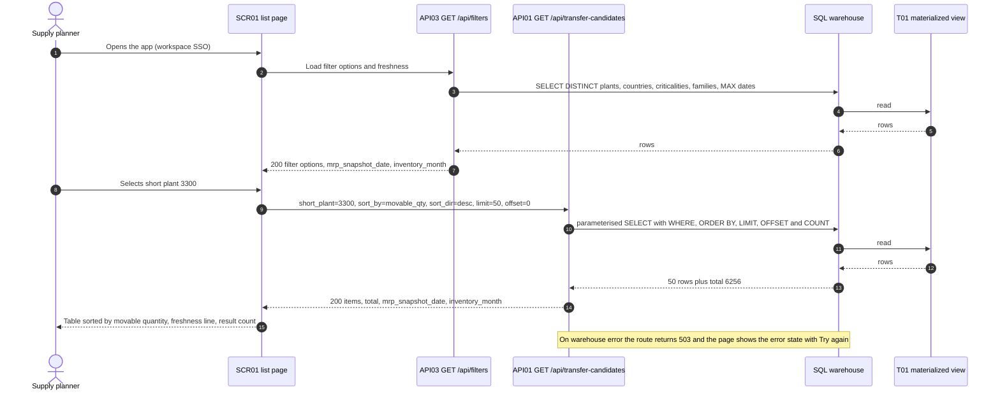
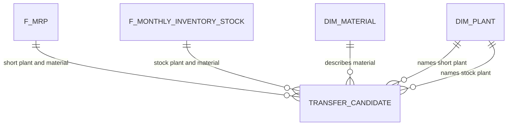

# TSD — Shortage Rebalancing: Short in One Plant, Stock Held in Another (MRPX-002) — Technical Solution Design

> **How this document is used**
>
> ```
> PRD(s) ──▶ Planner writes TSD.md + FEATURES_V1.md … FEATURES_Vn.md
>              │
>              ▼
>   Review in the Omnigent session (UI) ──▶ Pull request in ADO ──▶ Tech lead + product owner approve, merge
>              │
>              ▼
>   Builder builds FEATURES_V1.md feature by feature (one PR each) ──▶ then V2 … Vn
> ```
>
> - Feature sets are **incremental**: v1 is built and merged before v2 starts; each set leaves a working product.
> - The Builder implements the TSD and feature specs **literally**. Anything it would have to decide is a gap in
>   this document; the Builder stops and asks, and the Planner fixes the TSD or the feature set.
> - A change after approval = new TSD version (§17) + updated feature set(s) + re-approval in ADO.

| Field | Value |
|---|---|
| Document | TSD-MRPX-002 |
| Version | 1.0 |
| Status | Draft |
| Source PRD(s) | PRD-MRPX-002 v0.1 |
| Approved by / date | |
| Planner model | databricks-claude-fable-5-1 (Fable 5.1) |
| Feature sets | v1 … v2 (see §14) |
| Context library version | 2026.11.04-1 |

---

## 1. Overview

**Product summary:** The product shows supply planners, for the latest daily MRP result, every material that is short in one plant while another plant holds normal stock of the same material, and how much of the shortage that stock could cover (the smaller of shortage and stock). It consists of one governed gold materialized view in `sandbox_others.gold`, refreshed once a day after the MRP snapshot lands, and one Databricks App (FastAPI backend, React frontend) that reads only that view through a serverless SQL warehouse. Planners filter by plant, country, criticality and product family, see the MRP result date and the inventory month on every screen, and open one material to see all plants that hold stock for it. The outcome is that transfer requests replace expedited purchases where usable stock already exists.

**In scope (all PRDs):**
- Gold materialized view T-01 `sandbox_others.gold.agg_mrpx_transfer_candidate_plant_pair`: one row per short material, short plant and plant holding stock (PRD §4b, US-1, US-2, US-3, US-5, US-7).
- Daily refresh after 06:30 (BR-07) through the view's own schedule.
- Databricks App APP with two screens: transfer candidates list with filters (SCR-01; US-1, US-2, US-3, US-4, US-6, US-7) and material shortage detail (SCR-02; US-2, US-5).
- Validation extract per plant for the product owner's two plants (PRD §3 success measure).
- Integration tests that prove the golden example (PRD §6) and the data-quality rules.

**Out of scope:**
- Transfer orders, purchase orders or any write to SAP — PRD §8; the source is read-only (PRD §9).
- Forecasting, alerts, e-mails, currency conversion — PRD §4b and §8.
- Judging whether a transfer is allowed or whether stock is excess — PRD §8; the view lists candidates only.
- A separate Lakeview dashboard or a Genie space — PRD §4b names the app as the only user-facing product.
- Row-level access per plant — PRD §2 names one general planning audience; every user with access to the app sees every plant.
- MVP and Prod hardening (certified sources, monitoring, SLAs) — PRD §10 requests PoC only; later sets are planned after PoC acceptance.

## 2. Architecture

### 2.1 System context — who and what the product talks to



| External party / system | Direction | Interface | Frequency | Owner |
|---|---|---|---|---|
| SAP MRP result (SRC-01 `sandbox_others.sap_test.f_mrp`) | in | Unity Catalog Delta table, daily full snapshot keyed by `SNAPSHOT_DATE` | daily, complete by 06:00 local (BR-07) | Supply Chain Analytics |
| SAP inventory stock (SRC-02 `sandbox_others.sap_test.f_monthly_inventory_stock`) | in | Unity Catalog Delta table, one row per material, plant, storage location and month | monthly | Supply Chain Analytics |
| SAP material master (SRC-03 `gops_dev.test.sap_extract_dim_material`) | in | Unity Catalog Delta table, full load per `BATCHRUN_DATE` | daily load | Supply Chain Analytics (to confirm) |
| SAP plant master (SRC-04 `sandbox_others.sap_test.dim_plant`) | in | Unity Catalog Delta table, 108 rows | on change | Supply Chain Analytics |
| Supply planners, team leads, Head of Supply Chain Planning (about 25 people) | out | Databricks App screens SCR-01, SCR-02 | daily from 07:30 (BR-07) | Head of Supply Chain Planning |

### 2.2 Component architecture — the building blocks



| Component | Type (pipeline / job / AI function / agent / app / dashboard / table / endpoint) | Responsibility | Module (§4) | Feature set |
|---|---|---|---|---|
| T-01 | table (materialized view with `SCHEDULE`) | Compute the transfer candidates: latest MRP snapshot shortages joined to latest-month normal stock in another plant, enriched with material and plant master; the only object the app reads | `pipelines` | v1 |
| VAL-01 | job (manual SQL script) | Produce the validation extract for one plant so the product owner's planners can confirm the candidates (PRD §3) | `pipelines` | v1 |
| API-01 … API-04 | endpoint (FastAPI in the Databricks App) | Read T-01 through the SQL warehouse with filters, sorting and paging; validate input; no business logic beyond filtering | `backend` | v2 |
| APP | Databricks App (React frontend served by the FastAPI backend) | Screens SCR-01 and SCR-02 for the planners; workspace SSO | `frontend` | v2 |

### 2.3 Data flow and lineage — how data moves, table by table



| Step | From | To | Transformation | Run by | Built in |
|---|---|---|---|---|---|
| 1 | SRC-01 | T-01 (CTE `short`) | filter to `SNAPSHOT_DATE = MAX(SNAPSHOT_DATE)` (BR-02); keep `MRP_SHORTAGE_QUANTITY > 0` (BR-05); `SUM(MRP_SHORTAGE_QUANTITY)`, `MAX(CAST(ESTIMATED_WEEKS_LATE AS INT))` (BR-06), `MIN(BASE_UNIT_OF_MEASURE)` per `PLANT`, `MATERIAL` | T-01 refresh | v1 / F-01 |
| 2 | SRC-02 | T-01 (CTE `stock`) | filter to `CALENDAR_YEAR_MONTH = MAX(CALENDAR_YEAR_MONTH)`; keep normal stock (`SPECIAL_STOCK_INDICATOR` NULL or empty); `SUM(TOTAL_QUANTITY)` per `PLANT`, `MATERIAL`; keep sums `> 0` | T-01 refresh | v1 / F-01 |
| 3 | SRC-03 | T-01 (CTE `mat`) | filter to `BATCHRUN_DATE = MAX(BATCHRUN_DATE)`; one row per `MATERIAL_KEY` by `ROW_NUMBER() OVER (PARTITION BY MATERIAL_KEY ORDER BY CHANGED_ON DESC NULLS LAST, MATERIAL ASC) = 1` | T-01 refresh | v1 / F-01 |
| 4 | `short` + `stock` + `mat` + SRC-04 | T-01 | INNER JOIN `short` to `stock` on `MATERIAL` where `short.PLANT <> stock.PLANT`; LEFT JOIN `mat` on `MATERIAL = MATERIAL_KEY`; LEFT JOIN SRC-04 twice on `PLANT_KEY` (BR-03), unmatched plant name `'UNKNOWN PLANT'`; `movable_qty = LEAST(shortage_qty, stock_qty)` | T-01 refresh | v1 / F-01 |
| 5 | T-01 | APP | filtered, sorted, paged reads (API-01 … API-04) | app backend | v2 / F-02 … F-04 |

### 2.4 Runtime flows — what happens, step by step

**Flow RF-01 — Planner reviews the transfer candidates of a plant**



| Step | Component | Input | Output | Error handling |
|---|---|---|---|---|
| 1 | SCR-01 | user opens `/` | page skeleton (loading state) | — |
| 2–7 | API-03 | none | `FilterOptions` JSON | warehouse error → 503 `{"detail": "The transfer candidates could not be loaded. Try again."}`; page shows error state, keeps filters |
| 8–15 | API-01 | query string filters, sort, paging | `CandidatePage` JSON | invalid filter value → 422 with the offending field; warehouse error → 503 as above |
| 16 | SCR-01 | `CandidatePage` | table, count line "6,256 candidates", freshness line | 0 items → empty state "No transfer candidates match these filters." with "Clear filters" |

**Flow RF-02 — Planner opens one material to see every plant holding stock:** SCR-01 row click → SCR-02 at `/materials/{material}/plants/{short_plant}` → API-02 `GET /api/transfer-candidates/{material}/{short_plant}` → one parameterised SELECT on T-01 → 200 `MaterialDetail` (material header, shortage, weeks late, holding plants sorted by `movable_qty` desc) or 404 `{"detail": "Material 1236-561-01 is not short in plant 3300 in the current MRP result."}` → SCR-02 renders the detail or its not-found state with a link back to SCR-01.

**Flow RF-03 — Daily refresh of T-01 (failure path):** at 06:45 Asia/Singapore the materialized view's `SCHEDULE` runs a full refresh. If a `FAIL UPDATE` expectation fails (null key, non-positive movable quantity, equal plants), the refresh fails, T-01 keeps yesterday's rows, the pipeline event log records the failure, and SCR-01 shows the freshness warning "MRP result is from 2026-08-30, 1 day old" because `mrp_snapshot_date` is older than yesterday. No alert is sent in PoC (PRD §4b excludes alerts); the Data Eng on-duty checks the pipeline UI (§13).

### 2.5 Deliberately not used

- No AI function and no agent — the logic is deterministic SQL (joins, filters, `LEAST`); rubric step 1 applies.
- No ML model — nothing is predicted or scored; the PRD §4b excludes a model.
- No separate Lakeview dashboard or Genie space — PRD §4b names the Databricks App as the only user-facing product; the earlier "Inventory Stock Health" dashboard and "Material Planning and Procurement Risks" Genie space (found by Genie One) cover stock value and one-plant risks, not plant-to-plant candidates.
- No bronze or silver copies — the four sources are conformed SAP extracts already in Unity Catalog; `data_engineering` skill §1 (raw copies kept unchanged are treated as bronze) and §2 (clean master tables are read directly, not copied). The only derived object is the gold materialized view.
- No notebook and no Lakeflow Job for T-01 — the result is expressible in one SQL statement in batch, so `data_engineering` skill §2 selects a materialized view with its own `SCHEDULE` (§9: no job task for it).
- No `sandbox_others.sap_test.bw_mrp_testpull_api` — BR-01 forbids it.
- No `sandbox_others.bronze_sap_extract.sap_extract_dim_material` (10 rows) — the library source decision selects the table with the most records, `gops_dev.test.sap_extract_dim_material`.
- No `sandbox_others.sap_test.ml_excess_obsolete_inventory_risk` as the stock side — Genie One reported an earlier variant matching shortages to flagged excess stock; PRD §8 excludes judging whether stock is excess, so the view uses all normal stock.
- No existing gold view reused — `sandbox_others.gold.invh_stale_stock` and `invh_value_by_plant_month` aggregate stock value by plant and staleness; neither has the material–plant-pair grain or the MRP side (reuse check, §18).
- No `REGION` filter — BR-04 (empty for 78 of 108 plants); geography is `COUNTRY_KEY`.
- No amount or price columns (`TOTAL_VALUE`, `STANDARD_PRICE`, `MFG_COST_PRICE`) — BR-09 and PRD §8 (no currency conversion); the audience is general planning.
- No `CREATED_BY` / `CHANGED_BY` from the material master — personal data (BR-09, PRD §9).
- No Lakebase / Postgres — the app is read-only on one gold view; no app-side writes exist.
- No per-user row filter — PRD §2 defines one general audience of about 25 planners.

## 3. Technology decisions

| Area | Decision (exact) | Version / pin | Reason | Rejected alternatives |
|---|---|---|---|---|
| Language | Python (backend), TypeScript (frontend) | Python 3.11; TypeScript 5.6.3 | §11.1 standard stack for Databricks Apps | — |
| Data processing | One Spark SQL `CREATE OR REPLACE MATERIALIZED VIEW` (T-01) with `SCHEDULE CRON '0 45 6 * * ?' AT TIME ZONE 'Asia/Singapore'`; engine: Spark SQL on the pipeline's serverless compute (built-in functions only, `data_engineering` references/spark-and-python.md §1 option 1). Full refresh each run because of the `MAX(...)` scalar subqueries (skill §2); slice read per refresh: 5,590,830 `f_mrp` rows of one snapshot, 144,631 stock rows of one month, 911,879 material rows of one batch, 108 plant rows; output 115,077 rows (2026-08-30 / 202608) | Databricks SQL (current) | `data_engineering` skill §2 row 2: derived from existing tables, expressible in SQL, batch; BR-07 refresh after 06:30 | Notebook + Lakeflow Job (skill §2 reserves it for Python or multi-step logic); plain view (would scan 5.6M MRP rows on every app request and miss the 5 s target) |
| Storage | Unity Catalog Delta; materialized view in `sandbox_others.gold` | — | Skill §3 PoC exception: PoC objects live in `sandbox_others`; existing gold views of earlier projects live in `sandbox_others.gold` (§18) | New schema `gold_mrpx` (one schema per project is not the existing pattern) |
| App data access | `databricks-sql-connector` to the serverless SQL warehouse bound to the app as resource `sql-warehouse`, authenticated as the app's service principal via `databricks.sdk.core.Config` (OAuth M2M from the environment variables Databricks Apps injects); engine: SQL on the warehouse, parameterised queries only | databricks-sql-connector 3.6.0; databricks-sdk 0.38.0 | PRD §4b: the app queries the view through a SQL warehouse; parameters stop SQL injection | Spark Connect from the app (heavier, no warehouse); on-behalf-of-user tokens (not needed: one audience, no row-level security) |
| LLM access | N/A — no LLM calls (§2.5) | — | deterministic SQL | — |
| App framework | FastAPI backend serving the built React + Vite + Tailwind frontend from `backend/static/` | fastapi 0.115.5; uvicorn 0.32.0; react 18.3.1; vite 5.4.10; tailwindcss 3.4.14 | §11.1 standard; `ui_ux_design` §10 (Tailwind with `asm.*` tokens) | AppKit / Streamlit / Dash (not the team standard; tablet layout rules of `ui_ux_design` §2 need custom CSS) |
| Routing (frontend) | react-router-dom, two routes `/` and `/materials/:material/plants/:shortPlant` | 6.28.0 | two screens with a deep link per material | hash router (breaks the deep link copy from SCR-02) |
| Icons | lucide-react, 16 px desktop / 20 px tablet | 0.456.0 | `ui_ux_design` §3 | — |
| Testing | pytest (unit with fakes, integration marker); vitest + Testing Library for the frontend | pytest 8.3.3; httpx 0.27.2; vitest 2.1.4; @testing-library/react 16.0.1; @testing-library/jest-dom 6.6.3; jsdom 25.0.1 | §12 | — |
| Lint | ruff, line length 100 | 0.7.3 | §11.2 | — |
| Deployment | Databricks Asset Bundle `databricks.yml` with one `apps` resource and `app.yaml`; target `dev` only in PoC | Databricks CLI 0.230.0 or later | §10; `data_engineering` skill §9 | manual app creation in the UI (not repeatable) |
| Allowed libraries | Backend: `fastapi==0.115.5`, `uvicorn==0.32.0`, `pydantic==2.9.2`, `databricks-sql-connector==3.6.0`, `databricks-sdk==0.38.0`; backend dev: `pytest==8.3.3`, `httpx==0.27.2`, `ruff==0.7.3`. Frontend: `react@18.3.1`, `react-dom@18.3.1`, `react-router-dom@6.28.0`, `lucide-react@0.456.0`; frontend dev: `typescript@5.6.3`, `vite@5.4.10`, `@vitejs/plugin-react@4.3.3`, `tailwindcss@3.4.14`, `postcss@8.4.47`, `autoprefixer@10.4.20`, `vitest@2.1.4`, `@testing-library/react@16.0.1`, `@testing-library/jest-dom@6.6.3`, `jsdom@25.0.1`, `@types/react@18.3.12`, `@types/react-dom@18.3.1`. The Builder may use nothing else. | as listed | exhaustive list | pandas (no in-app aggregation exists), axios (fetch is enough), react-query (two requests per screen) |

## 4. Project modules

The project follows the universal folder structure in §11.1. This section lists only **this project's** files
in it — the names every feature uses.

| Layer (§11.1) | File | Responsibility | Built in |
|---|---|---|---|
| pipelines | `MRPX-002/pipelines/sql/agg_mrpx_transfer_candidate_plant_pair.sql` | T-01 definition (`CREATE OR REPLACE MATERIALIZED VIEW`, expectations, schedule, comments) and its `GRANT SELECT` | v1 / F-01 |
| pipelines | `MRPX-002/pipelines/sql/validation_extract_by_plant.sql` | VAL-01: parameterised extract of all candidates of one short plant for planner confirmation | v1 / F-03 |
| pipelines | `MRPX-002/pipelines/sql/grant_app_service_principal.sql` | the three `GRANT` statements for the app service principal (§8) | v2 / F-08 |
| tests | `MRPX-002/pytest.ini`, `MRPX-002/tests/__init__.py`, `MRPX-002/tests/integration/__init__.py`, `MRPX-002/tests/unit/__init__.py`, `MRPX-002/tests/unit/repositories/__init__.py`, `MRPX-002/tests/unit/routers/__init__.py`, `MRPX-002/backend/__init__.py`, `MRPX-002/backend/repositories/__init__.py`, `MRPX-002/backend/services/__init__.py`, `MRPX-002/backend/routers/__init__.py` | marker `integration`, test paths, empty package markers | v1 / F-02, v2 / F-01 … F-03 |
| tests | `MRPX-002/tests/conftest.py` | shared fixtures (§12) | v1 / F-02 |
| tests | `MRPX-002/tests/integration/test_f01_transfer_candidate_view.py`, `MRPX-002/tests/unit/test_f02_fixtures.py` | SQL assertions on T-01 (grain, nulls, golden example); one test of the fake connection | v1 / F-02 |
| backend | `MRPX-002/backend/main.py` | app factory: registers routers, serves `backend/static/`, API-04 | v2 / F-01 |
| backend | `MRPX-002/backend/config.py` | `Settings` from environment; fails fast on a missing key (§10); `make_connection_factory(settings)` opening the warehouse connection (EXT-01) | v2 / F-01 |
| backend | `MRPX-002/backend/constants.py` | `PAGE_SIZE_DEFAULT`, `PAGE_SIZE_MAX`, `SORT_COLUMNS`, `CRITICALITY_VALUES`, `UNKNOWN_PLANT_NAME`, `CRITICALITY_NONE` | v2 / F-01 |
| backend | `MRPX-002/backend/models.py` | Pydantic models: `CandidateRow`, `CandidatePage`, `HoldingPlant`, `MaterialDetail`, `PlantOption`, `FilterOptions`, `Freshness`, `HealthResponse` | v2 / F-02 |
| repositories | `MRPX-002/backend/repositories/transfer_candidate_repository.py` | all SQL on T-01: `fetch_candidates`, `fetch_material_detail`, `fetch_filter_options`, `fetch_freshness` | v2 / F-02 |
| services | `MRPX-002/backend/services/transfer_candidate_service.py` | input validation and orchestration: `list_candidates`, `get_material_detail`, `get_filter_options` | v2 / F-03, F-04 |
| routers | `MRPX-002/backend/routers/transfer_candidates.py` | API-01, API-02 | v2 / F-03, F-04 |
| routers | `MRPX-002/backend/routers/filters.py` | API-03 | v2 / F-03 |
| app config | `MRPX-002/app.yaml`, `MRPX-002/pyproject.toml`, `MRPX-002/requirements.txt` | Databricks App start command and environment; Python packaging and pins | v2 / F-01 |
| frontend | `MRPX-002/frontend/package.json`, `vite.config.ts`, `tsconfig.json`, `tailwind.config.js`, `postcss.config.js`, `index.html`, `src/main.tsx`, `src/App.tsx`, `src/index.css`, `src/api.ts`, `src/types.ts`, `src/format.ts`, `src/__tests__/setup.ts`, `src/__tests__/format.test.ts` | scaffold, ASM tokens, typed API client, number and date formatting, vitest setup | v2 / F-05 |
| frontend | `MRPX-002/frontend/src/pages/TransferCandidatesPage.tsx`, `src/components/FilterBar.tsx`, `src/components/CandidatesTable.tsx`, `src/components/FreshnessLine.tsx`, `src/components/StateMessage.tsx` | SCR-01 | v2 / F-06 |
| frontend | `MRPX-002/frontend/src/pages/MaterialDetailPage.tsx`, `src/components/HoldingPlantsTable.tsx` | SCR-02 | v2 / F-07 |
| frontend tests | `MRPX-002/frontend/src/__tests__/TransferCandidatesPage.test.tsx`, `MaterialDetailPage.test.tsx`, `src/__tests__/fixtures.ts` | vitest tests for SCR-01 and SCR-02 | v2 / F-06, F-07 |
| bundle | `MRPX-002/databricks.yml` | Asset Bundle: app resource `mrpx_002_transfer_candidates` with the `sql-warehouse` resource, target `dev` | v2 / F-08 |
| tests | `MRPX-002/tests/unit/test_f01_app_factory.py`, `tests/unit/repositories/test_f02_transfer_candidate_repository.py`, `tests/unit/routers/test_f03_candidates_and_filters.py`, `tests/unit/routers/test_f04_material_detail.py`, `tests/integration/test_f08_app_against_warehouse.py` | unit tests of v2 and the in-process app test against the real warehouse | v2 |

**Screens (wireframe `plan/wireframe.html`; `ui_ux_design` §5 archetypes):**

| Screen | Name | Archetype | Primary action | User stories | Features | Route |
|---|---|---|---|---|---|---|
| SCR-01 | Transfer candidates | List / queue with an overview count line | Filter and open a material (row click) | US-1, US-2, US-3, US-4, US-6, US-7 | v2/F-06 (uses API-01, API-03) | `/` |
| SCR-02 | Material shortage detail | Detail | Back to the list (read-only screen; the transfer request itself is out of scope) | US-2, US-5, US-7 | v2/F-07 (uses API-02) | `/materials/:material/plants/:shortPlant` |

## 5. Data design

### 5.1 Catalogs and schemas per environment

| Environment | Catalog | Schemas | Notes |
|---|---|---|---|
| dev | `sandbox_others` | `gold` (T-01); sources in `sap_test` and `gops_dev.test` | PoC exception of `data_engineering` skill §3: PoC objects in `sandbox_others` |
| prod | N/A — PoC only (library `business/stages_and_approvals.md`); the prod catalog is set in the MVP TSD version | — | — |

Code never hard-codes catalog names; it reads config keys `CATALOG` / `SCHEMA_*` (§10).

### 5.2 Data sources and tables

| ID | Name / location | Layer (source / bronze / silver / gold / app) | Purpose | Fed by | Used by | PII |
|---|---|---|---|---|---|---|
| SRC-01 | `sandbox_others.sap_test.f_mrp` — 86 snapshots, about 409M rows; latest `SNAPSHOT_DATE` `2026-08-30` with 5,590,830 rows, 3,701,192 shortage rows, 75,556 short material–plant pairs. Columns used: `SNAPSHOT_DATE` STRING, `PLANT` STRING, `MATERIAL` STRING, `MRP_SHORTAGE_QUANTITY` DECIMAL, `ESTIMATED_WEEKS_LATE` STRING (zero-padded, all 3,701,192 shortage rows cast to INT, range 0–910), `BASE_UNIT_OF_MEASURE` STRING | source (treated as bronze) | shortages (BR-01, BR-02, BR-05, BR-06) | — | T-01 | N |
| SRC-02 | `sandbox_others.sap_test.f_monthly_inventory_stock` — 3,685,873 rows, 32 months `202401`–`202608`; latest month `202608` has 144,631 rows, all with blank `SPECIAL_STOCK_INDICATOR`. Columns used: `CALENDAR_YEAR_MONTH` STRING, `PLANT` STRING, `MATERIAL` STRING, `TOTAL_QUANTITY` DECIMAL, `SPECIAL_STOCK_INDICATOR` STRING, `BASE_UOM` STRING | source (treated as bronze) | stock held per plant (library `sap_stock_and_material_data.md`) | — | T-01 | N |
| SRC-03 | `gops_dev.test.sap_extract_dim_material` — 17,168,559 rows across loads; latest `BATCHRUN_DATE` `202611040335140501` has 911,879 rows for 911,820 distinct `MATERIAL_KEY` (59 duplicate rows). Columns used: `BATCHRUN_DATE` STRING, `MATERIAL_KEY` STRING, `MATERIAL` STRING (description), `MATERIAL_TYPE` STRING, `PRODUCT_HIER_LEVEL_1` STRING (product family), `CRITICALITY` STRING (A, B, C or blank), `CHANGED_ON` DATE | source (treated as bronze; clean master read in place) | material description, type, family, criticality (US-5) | — | T-01 | N (columns `CREATED_BY`, `CHANGED_BY` are never read) |
| SRC-04 | `sandbox_others.sap_test.dim_plant` — 108 rows, 82 with `COUNTRY_KEY`. Columns used: `PLANT_KEY` STRING, `PLANT` STRING (plant name), `COUNTRY_KEY` STRING | source (clean master read in place) | plant name and country (BR-03, BR-04) | — | T-01 | N |
| T-01 | `sandbox_others.gold.agg_mrpx_transfer_candidate_plant_pair` — materialized view, grain one row per (`material`, `short_plant`, `stock_plant`); 115,077 rows for snapshot `2026-08-30` and month `202608`; `CLUSTER BY (short_plant, material)`. Columns: `material` STRING, `material_description` STRING, `material_type` STRING, `product_family` STRING, `criticality` STRING (A, B, C or NULL), `short_plant` STRING, `short_plant_name` STRING, `short_plant_country` STRING, `stock_plant` STRING, `stock_plant_name` STRING, `stock_plant_country` STRING, `shortage_qty` DECIMAL(27,3), `stock_qty` DECIMAL(27,3), `movable_qty` DECIMAL(27,3), `weeks_late` INT, `unit_of_measure` STRING, `mrp_snapshot_date` DATE, `inventory_month` STRING (yyyyMM), `ETL_LOADDATE` DATE, `SOURCE_SNAPSHOT_DATE` DATE | gold | the governed view of PRD §4b; the only object the app reads | SRC-01, SRC-02, SRC-03, SRC-04 | API-01, API-02, API-03, API-04, VAL-01 | N |



## 6. APIs

### 6.1 APIs we build

| ID | Method + path | Purpose | Request (main fields) | Response (main fields) | Auth | Built in |
|---|---|---|---|---|---|---|
| API-01 | `GET /api/transfer-candidates` | Filtered, sorted, paged list for SCR-01 | query: `short_plant: list[str]`, `country: list[str]`, `criticality: list[str]` (values `A`, `B`, `C`, `NONE`), `product_family: list[str]`, `sort_by: str` (`movable_qty` default, `shortage_qty`, `stock_qty`, `weeks_late`), `sort_dir: str` (`desc` default, `asc`), `limit: int` (default 50, 1–200), `offset: int` (default 0, ≥ 0) | `200 {items: CandidateRow[], total: int, mrp_snapshot_date: date, inventory_month: str, limit: int, offset: int}` / `422` / `503` | workspace SSO (Databricks Apps) | v2 / F-03 |
| API-02 | `GET /api/transfer-candidates/{material}/{short_plant}` | Material detail with every plant holding stock for SCR-02 | path: `material: str`, `short_plant: str` | `200 MaterialDetail {material, material_description, material_type, product_family, criticality, short_plant, short_plant_name, short_plant_country, shortage_qty, weeks_late, unit_of_measure, mrp_snapshot_date, inventory_month, holding_plants: HoldingPlant[]}` / `404` / `503` | workspace SSO | v2 / F-04 |
| API-03 | `GET /api/filters` | Filter options and freshness for SCR-01 | — | `200 FilterOptions {short_plants: PlantOption[], countries: str[], criticalities: str[], product_families: str[], mrp_snapshot_date: date, inventory_month: str}` / `503` | workspace SSO | v2 / F-03 |
| API-04 | `GET /api/health` | Liveness for deployment checks | — | `200 {status: "ok", catalog: str, schema_gold: str}` | workspace SSO | v2 / F-01 |

### 6.2 External APIs we use

| ID | API / service | Provider | Endpoint / name | Purpose | Auth | If unavailable |
|---|---|---|---|---|---|---|
| EXT-01 | Databricks SQL Statement execution through `databricks-sql-connector` | Databricks | serverless SQL warehouse bound to the app as resource `sql-warehouse`; `http_path = /sql/1.0/warehouses/{DATABRICKS_WAREHOUSE_ID}` | all reads of T-01 | app service principal (OAuth M2M from `DATABRICKS_CLIENT_ID` / `DATABRICKS_CLIENT_SECRET`, injected by Databricks Apps) | routes return 503 with "The transfer candidates could not be loaded. Try again."; the screens show the error state |

## 7. AI agents to build

| ID | Agent name | Purpose |
|---|---|---|
| N/A | — | N/A — no agent; the logic is deterministic SQL (§2.5) |

## 8. Security and access

| Principal | Resource | Privilege | Why |
|---|---|---|---|
| Creator of T-01 (Data Eng engineer running F-01 in PoC; see D-07) | `sandbox_others.sap_test.f_mrp`, `f_monthly_inventory_stock`, `dim_plant`; `gops_dev.test.sap_extract_dim_material` | `USE CATALOG`, `USE SCHEMA`, `SELECT` | the materialized view reads them at refresh |
| Creator of T-01 | `sandbox_others.gold` | `USE SCHEMA`, `CREATE MATERIALIZED VIEW` | create and own T-01 |
| `account users` | `sandbox_others.gold.agg_mrpx_transfer_candidate_plant_pair` | `SELECT` | planners and the app read it; pattern of the existing gold views (§18); no confidential column (BR-09) |
| App service principal (created by Databricks Apps for `mrpx-002-transfer-candidates`) | `sandbox_others` / `sandbox_others.gold` / T-01 | `USE CATALOG`, `USE SCHEMA`, `SELECT` | API-01 … API-03 read T-01 |
| App service principal | SQL warehouse `sql-warehouse` | `CAN USE` | run the queries |
| Supply planners, team leads, Head of Supply Chain Planning | Databricks App `mrpx-002-transfer-candidates` | `CAN USE` | open the screens (PRD §2) |

Secrets: none. Databricks Apps injects the service principal credentials and the warehouse id as environment variables; no secret scope is needed. No secrets in code or config files.

## 9. Non-functional requirements

| Area | Target | How verified |
|---|---|---|
| Latency | any plant view in SCR-01 renders in under 5 s (PRD §7); API-01 for one plant with `limit=50` answers in under 2 s on the serverless warehouse | `tests/integration/test_f08_app_against_warehouse.py` times `GET /api/transfer-candidates?short_plant=3300&limit=50` five times after one warm-up call; every call under 2 s; manual check of SCR-01 under 5 s |
| Volume | T-01 115,077 rows (22 short plants, 34 stock plants, 18,348 materials); largest plant 3300 with 6,256 rows; about 25 users | `SELECT COUNT(*) FROM T-01` in `test_f01_transfer_candidate_view.py`; paging caps responses at 200 rows |
| Freshness | T-01 refreshed daily after 06:30 local (BR-07): schedule 06:45 Asia/Singapore; SCR-01 shows `mrp_snapshot_date` and `inventory_month` (PRD §7, US-7) and a warning when `mrp_snapshot_date` is older than yesterday | pipeline event log of T-01; `FreshnessLine` test in `TransferCandidatesPage.test.tsx` |
| Availability | PoC: workspace hours; no SLA (library `business/stages_and_approvals.md`: SLAs are a Prod addition) | — |
| Cost | one full refresh per day over 5.6M + 0.14M + 0.9M rows on serverless; app queries hit a 115k-row clustered materialized view | pipeline run duration in the event log under 10 minutes |
| Confidentiality | no prices, amounts, vendor or personal data in T-01 or the app (BR-09, PRD §9) | column list of T-01 (§5.2) checked in `test_f01_transfer_candidate_view.py` |

## 10. Environments and deployment

Deployed with a Databricks Asset Bundle (`databricks.yml`) to targets `dev` and `prod`; prod only from `main`.
PoC exception: only target `dev` is defined in this TSD version (`business/stages_and_approvals.md`).

| Config key | dev value | prod value |
|---|---|---|
| `CATALOG` | `sandbox_others` | N/A — PoC only |
| `SCHEMA_GOLD` | `gold` | N/A — PoC only |
| `VIEW_TRANSFER_CANDIDATES` | `agg_mrpx_transfer_candidate_plant_pair` | N/A — PoC only |
| `DATABRICKS_WAREHOUSE_ID` | injected by the app resource `sql-warehouse` (`valueFrom: sql-warehouse` in `app.yaml`) | N/A — PoC only |
| `DATABRICKS_HOST`, `DATABRICKS_CLIENT_ID`, `DATABRICKS_CLIENT_SECRET` | injected by Databricks Apps | N/A — PoC only |
| `APP_NAME` (bundle) | `mrpx-002-transfer-candidates` | N/A — PoC only |
| `warehouse_id` (bundle variable) | id of the team's serverless SQL warehouse, passed with `--var="warehouse_id=<id>"` | N/A — PoC only |

## 11. Universal context (team standards every feature follows)

### 11.1 Backend folder structure (FastAPI on Databricks Apps)

```
MRPX-002/
  backend/
    main.py              app factory: routers registered, static frontend served
    config.py            settings from environment / app resources; fails fast if a required key is missing
    constants.py         project constants (this project's addition; §4)
    models.py            Pydantic request / response models (one per API in §6.1)
    routers/             one file per resource: HTTP only — validate, call a service, return
    services/            business logic and agent orchestration; no SQL, no HTTP
    repositories/        all data access (SQL on Unity Catalog / Lakebase); one file per table group
    agents/              N/A — no agent in this project (§7)
  frontend/              React + Vite + Tailwind; build output copied to backend/static/
  pipelines/
    sql/                 SQL definitions (T-01 materialized view, VAL-01 extract); no notebooks in this project
  tests/
    unit/                mirrors backend/ (fakes for Databricks access)
    integration/         marker `integration`; real tables in dev
  app.yaml               Databricks App start command and environment
  databricks.yml
  pyproject.toml
  requirements.txt
```

Layer rule: routers → services → repositories. A router never runs SQL; a repository never contains business logic.

Project-specific exceptions: no `agents/` folder; `pipelines/` holds SQL files only (a materialized view needs no notebook, `data_engineering` skill §2); `backend/constants.py` added for the values in §4.

### 11.2 Coding conventions

- **Naming:** files and functions `snake_case`; classes `PascalCase`; tables `{layer}_{entity}` (gold: `agg_<metric>_<grain>` per `data_engineering` skill §3, here `agg_mrpx_transfer_candidate_plant_pair`); columns `snake_case`, dates end in `_date`; audit columns keep the fixed names `ETL_LOADDATE`, `SOURCE_SNAPSHOT_DATE` (skill §6); API paths `/api/{plural-resource}`; tests `test_{feature_id}_{ac_id}_{behaviour}`.
- **Style:** ruff, line length 100; type hints on all public functions.
- **Errors:** `ValueError` for bad input (→ 422), `PermissionError` for ownership (→ 403), not found → 404; warehouse or connector errors → 503; never swallow exceptions.
- **Logging:** `logging.getLogger(__name__)`; no PII or secrets in logs; the `X-Forwarded-Email` header Databricks Apps adds is never read or logged (PRD §9).
- **Time:** T-01 holds dates only (`mrp_snapshot_date`, `inventory_month`); the app displays them as `30 Aug 2026` and `Aug 2026` in the browser locale `en-GB`; the refresh schedule runs in `Asia/Singapore` (D-06).
- **Secrets:** Databricks secret scopes or app resources only — never in code or config files. This project needs none (§8).
- **Dependencies:** only §3 "Allowed libraries".
- **UI:** `ui_ux_design` §3 tokens as Tailwind `asm.*` colours and `--asm-*` CSS variables; Inter for text, JetBrains Mono for material and plant codes; tabular numbers right-aligned; 1024 px breakpoint; 44 px targets desktop, 48 px tablet; status colour always paired with a word.

## 12. Testing strategy

| Level | Tool | Location | Runs where | Notes |
|---|---|---|---|---|
| Unit | pytest | `tests/unit/` mirroring `backend/` | sandbox / CI | Databricks access replaced by fakes in `tests/conftest.py` |
| Integration | pytest, marker `integration` | `tests/integration/` | dev workspace | real T-01 through `databricks-sql-connector`; real deployed app through `httpx` |
| Frontend unit | vitest + @testing-library/react (jsdom) | `frontend/src/__tests__/` | sandbox / CI | `fetch` replaced by `vi.fn()` returning the fixtures in `fixtures.ts` |
| Agent evaluation | N/A — no agent (§7) | — | — | — |

Shared fixtures (`tests/conftest.py`):
- `golden_row`: `dict` of one T-01 row — `material='1236-561-01'`, `material_description='EMI GASKET / SPIRAL / SSN-053W'`, `material_type='HALB'`, `product_family='PE'`, `criticality='A'`, `short_plant='3300'`, `short_plant_name='ASM Korea Ltd.'`, `short_plant_country='KR'`, `stock_plant='1000'`, `stock_plant_name='UNKNOWN PLANT'`, `stock_plant_country=None`, `shortage_qty=Decimal('336233.000')`, `stock_qty=Decimal('356500.000')`, `movable_qty=Decimal('336233.000')`, `weeks_late=9`, `unit_of_measure='MM'`, `mrp_snapshot_date=date(2026, 8, 30)`, `inventory_month='202608'`.
- `sample_rows`: `list[dict]` of three T-01 rows: `golden_row`; row B `material='1226-807-01'`, `material_description='EMI GASKET / SPIRAL / SSN-036W'`, `material_type='HALB'`, `product_family='CP'`, `criticality='C'`, `short_plant='3300'`, `short_plant_name='ASM Korea Ltd.'`, `short_plant_country='KR'`, `stock_plant='3320'`, `stock_plant_name='ASM Korea Ltd.'`, `stock_plant_country='KR'`, `shortage_qty=Decimal('2035876.000')`, `stock_qty=Decimal('60000.000')`, `movable_qty=Decimal('60000.000')`, `weeks_late=13`, `unit_of_measure='MM'`, same dates; row C `material='1232-405-01'`, `material_description='EMI GASKET / SPIRAL / SSN-028W'`, `material_type='HALB'`, `product_family='CP'`, `criticality='A'`, `short_plant='3300'`, `short_plant_name='ASM Korea Ltd.'`, `short_plant_country='KR'`, `stock_plant='3320'`, `stock_plant_name='ASM Korea Ltd.'`, `stock_plant_country='KR'`, `shortage_qty=Decimal('55730.000')`, `stock_qty=Decimal('60000.000')`, `movable_qty=Decimal('55730.000')`, `weeks_late=12`, `unit_of_measure='MM'`, same dates.
- `fake_connection`: class `FakeConnection` with `cursor()` returning `FakeCursor`; `FakeCursor.execute(sql, parameters)` appends `(sql, parameters)` to `FakeCursor.calls` and sets `rows` from `FakeConnection.queued_results.pop(0)`; `fetchall()` returns `rows` as `FakeRow` objects exposing `.asDict()`; `description` returns column names; usable as a context manager.
- `settings`: `Settings(catalog='sandbox_others', schema_gold='gold', view_transfer_candidates='agg_mrpx_transfer_candidate_plant_pair', databricks_host='https://example.cloud.databricks.com', databricks_warehouse_id='abc123')`.
- `client`: `fastapi.testclient.TestClient(create_app(settings, connection_factory=lambda: fake_connection))`.
- `integration_connection` (marker `integration`): real `databricks.sql.connect(...)` from environment variables `DATABRICKS_HOST`, `DATABRICKS_WAREHOUSE_ID`, `DATABRICKS_TOKEN`; skipped when any is missing.

## 13. Observability and operations

Traces: N/A — no agent. Pipeline: the materialized view's event log (expectation pass/fail counts, refresh duration) in the Pipelines UI of the workspace. App: Databricks Apps logs (uvicorn access log and `logging` output at INFO). Alerts: none in PoC (PRD §4b excludes alerts; `stages_and_approvals.md` adds monitoring in MVP). Runbook: `MRPX-002/plan/TSD.md` §2.4 RF-03 (failed refresh: open the pipeline for T-01, read the failed expectation, fix the source or the definition, trigger `REFRESH MATERIALIZED VIEW sandbox_others.gold.agg_mrpx_transfer_candidate_plant_pair`).

## 14. Feature-set roadmap

| Set | Goal (what works after this set) | Features | Depends on | Exit criteria |
|---|---|---|---|---|
| v1 | v1 — PoC core data: the governed view T-01 exists in `sandbox_others.gold`, refreshes daily, reproduces the golden example, and the product owner's planners receive the validation extract for their two plants | F-01 create T-01; F-02 integration tests for T-01; F-03 validation extract VAL-01 | — | `SELECT COUNT(*) FROM T-01` > 0; grain unique; golden example row returned exactly; `validation_extract_by_plant.sql` with `:short_plant = '3300'` returns 6,256 rows with the golden row first |
| v2 | v2 — PoC app: planners open the Databricks App in dev with workspace SSO, filter candidates by plant, country, criticality and product family, see the MRP date and inventory month, and open a material to see every plant holding stock | F-01 backend scaffold and API-04; F-02 repository and models; F-03 API-01 and API-03; F-04 API-02; F-05 frontend scaffold; F-06 SCR-01; F-07 SCR-02; F-08 bundle and dev deployment | v1 | all unit tests green; `GET /api/transfer-candidates?short_plant=3300` on the deployed app returns `total = 6256` and the golden row first in under 2 s; SCR-01 and SCR-02 show the golden example as in `plan/wireframe.html` |

## 15. Traceability (PRD → design → features)

| PRD requirement | TSD section | Feature(s) |
|---|---|---|
| PRD-MRPX-002 US-1 (short materials in stock elsewhere, per plant) | §5.2 T-01, §6.1 API-01, §4 SCR-01 | v1/F-01, v2/F-03, v2/F-06 |
| PRD-MRPX-002 US-2 (shortage, stock, holding plant, movable quantity) | §5.2 T-01 columns `shortage_qty`, `stock_qty`, `stock_plant`, `movable_qty`; §6.1 API-01, API-02 | v1/F-01, v2/F-02, v2/F-06, v2/F-07 |
| PRD-MRPX-002 US-3 (weeks late) | §5.2 T-01 `weeks_late` (BR-06); §6.1 API-01 sort | v1/F-01, v2/F-03, v2/F-06 |
| PRD-MRPX-002 US-4 (filter by country) | §5.2 T-01 `short_plant_country` (BR-04); §6.1 API-01 `country`, API-03 | v1/F-01, v2/F-03, v2/F-06 |
| PRD-MRPX-002 US-5 (description, type, family, criticality) | §5.2 T-01 `material_description`, `material_type`, `product_family`, `criticality`; §6.1 API-02; §4 SCR-02 | v1/F-01, v2/F-04, v2/F-07 |
| PRD-MRPX-002 US-6 (filter by criticality and product family) | §6.1 API-01 `criticality`, `product_family`; API-03 | v2/F-03, v2/F-06 |
| PRD-MRPX-002 US-7 (MRP result date and inventory month) | §5.2 T-01 `mrp_snapshot_date`, `inventory_month`; §6.1 API-01, API-02, API-03; `FreshnessLine` | v1/F-01, v2/F-03, v2/F-06, v2/F-07 |
| PRD-MRPX-002 §3 success measure (planners confirm two plants) | §2.2 VAL-01 | v1/F-03 |
| PRD-MRPX-002 §4b governed view | §5.2 T-01 | v1/F-01, v1/F-02 |
| PRD-MRPX-002 §4b Databricks App, SSO, SQL warehouse | §3, §6, §8, §10 | v2/F-01, v2/F-05, v2/F-08 |
| PRD-MRPX-002 §6 golden example | §12 `golden_row` | v1/F-02, v2/F-02, v2/F-06, v2/F-07, v2/F-08 |
| PRD-MRPX-002 §7 NFR under 5 s, daily refresh, dates shown | §9 | v1/F-01, v2/F-06, v2/F-08 |
| PRD-MRPX-002 §9 guardrails (no personal data, read-only) | §2.5, §8, §11.2 | v1/F-01, v1/F-02 |

## 16. Decisions, risks, open questions

| ID | Type (decision / risk / question) | Statement | Status |
|---|---|---|---|
| D-01 | decision | T-01 is a materialized view with its own schedule, not a notebook plus job: `data_engineering` skill §2 (SQL-expressible batch derivation). Full refresh accepted; slice row counts in §3. | decided |
| D-02 | decision | Shortage side: `sandbox_others.sap_test.f_mrp`, one snapshot, `MRP_SHORTAGE_QUANTITY > 0`, `SUM` per plant and material, `MAX(CAST(ESTIMATED_WEEKS_LATE AS INT))` — BR-01, BR-02, BR-05, BR-06. | decided |
| D-03 | decision | Stock side: `sandbox_others.sap_test.f_monthly_inventory_stock` (3,685,873 rows; the only inventory table), latest `CALENDAR_YEAR_MONTH`, normal stock only (`SPECIAL_STOCK_INDICATOR` NULL or empty, PRD §6), sums `> 0` — library `sap_stock_and_material_data.md`. In the data every row is normal stock, so the filter currently removes nothing. | decided |
| D-04 | decision | Material master: `gops_dev.test.sap_extract_dim_material` (17,168,559 rows; largest copy), latest `BATCHRUN_DATE`, description = column `MATERIAL`, product family = `PRODUCT_HIER_LEVEL_1` (golden example value `PE` matches), criticality = `CRITICALITY` — library source decision of 2026-10-28. Genie One's statement that the table has no description column was checked and is wrong (`MATERIAL` = 'EMI GASKET / SPIRAL / SSN-053W' for `1236-561-01`). | decided |
| D-05 | decision | Plant join on `PLANT_KEY` with LEFT JOIN, unmatched name `'UNKNOWN PLANT'`, country NULL; geography by `COUNTRY_KEY` — BR-03, BR-04. Plant `1000` (holding stock for 10,351 pairs and short for 14,835 pairs) has no `dim_plant` row and shows as `UNKNOWN PLANT`. | decided |
| D-06 | decision | Refresh schedule `0 45 6 * * ?` in time zone `Asia/Singapore` (BR-07 "after 06:30 local"; the library does not name the zone; the skill example uses Asia/Singapore). | assumed — confirm |
| D-07 | decision | In PoC the engineer who runs F-01 creates and owns T-01; `data_engineering` skill §2 asks for the job's service principal, but no pipeline service principal exists for `sandbox_others` in PoC. Ownership moves to a service principal in the MVP TSD version. | assumed — confirm |
| D-08 | decision | `GRANT SELECT` on T-01 to `account users`, the pattern of the existing `sandbox_others.gold` views (§18). T-01 holds no price, amount, vendor or personal column, so BR-09 allows a general audience. | assumed — confirm |
| D-09 | decision | The user interface is a Databricks App, as PRD §4b mandates, although the rubric alone (users view and filter, no record actions) would give an AI/BI dashboard; PRD §4b explicitly excludes a Lakeview dashboard. `stages_and_approvals.md` allows a PoC user interface when it is the PRD's primary deliverable, which §4b states. | decided |
| D-10 | decision | Column `unit_of_measure` (`MIN(BASE_UNIT_OF_MEASURE)` of the MRP rows) is added to T-01 so quantities are never shown without their unit; MRP and stock units agree for all 115,077 pairs (checked). | decided |
| D-11 | decision | Material-master duplicates (59 rows in the latest batch) are resolved by `ROW_NUMBER() OVER (PARTITION BY MATERIAL_KEY ORDER BY CHANGED_ON DESC NULLS LAST, MATERIAL ASC) = 1`. The duplicates differ in description and product family, not in criticality. | assumed — confirm |
| D-12 | decision | No alerts, no monitoring job and no prod target in PoC (PRD §4b, `stages_and_approvals.md`). A failed refresh is visible as a stale `mrp_snapshot_date` on SCR-01. | decided |
| D-13 | decision | Gold naming follows `data_engineering` skill §3 (`agg_<metric>_<grain>`) with the project prefix inside the name: `agg_mrpx_transfer_candidate_plant_pair`. Existing gold views use `<project>_<entity>` without `agg_`; the skill is the mandatory default. | decided |
| D-14 | decision | No per-user plant restriction and no reading of the `X-Forwarded-Email` header: one general planning audience (PRD §2), no personal data (PRD §9). | decided |
| R-01 | risk | The same stock quantity appears in several pairs (one holding plant can cover shortages in several plants). Summing `movable_qty` across rows overstates what can move. SCR-01 shows no sum of `movable_qty`; SCR-02 lists every holding plant for one shortage only. | open — accepted for PoC |
| R-02 | risk | The sources are out of step: MRP snapshot `2026-08-30`, inventory month `202608`, material master batch of 2026-11-04. Descriptions and criticality are the newest master values, not the values at the MRP date. | open — accepted for PoC |
| R-03 | risk | `ESTIMATED_WEEKS_LATE` reaches 910 weeks in the snapshot; the view shows it as given (BR-06 forbids recomputation). | open — accepted for PoC |
| Q-01 | question | No governed or certified definition exists for shortage, stock, movable quantity or criticality (Genie One, completed). The library rules BR-05 and BR-06 and PRD §6 are used. Does the product owner certify the T-01 definition at PoC acceptance? | open |
| Q-02 | question | What do criticality `A`, `B`, `C` mean in business terms, and how should the 13 candidate materials with blank criticality be labelled? The app shows them as "Not set" (filter value `NONE`). | open |
| Q-03 | question | Which two plants has the product owner named for the validation extract (PRD §3)? `3300` is used in the acceptance criteria because it carries the golden example. | open |
| Q-04 | question | The library file `sap_stock_and_material_data.md` is ACTIVE (draft, owner to confirm). Its facts were re-checked against the data on 2026-11-11 (row counts updated in §5.2). Does Supply Chain Analytics confirm the file? | open |

## 17. Change log

| Version | Date | Change | Sections | Source (PRD / CR) | Approved by |
|---|---|---|---|---|---|
| 1.0 | 2026-11-11 | Initial design | all | PRD-MRPX-002 v0.1 | |

## 18. Sources consulted

**Context library (`/Volumes/sandbox_others/omnigent_test/planner_context`, version 2026.11.04-1):** `VERSION`; `INDEX.md`; `core/dos_and_donts.md`; `core/glossary.md`; `business/sap_mrp_data.md` (BR-01, BR-02, BR-05, BR-06); `business/sap_stock_and_material_data.md` (ACTIVE draft; source decision, stock and material notes); `business/plants_and_geography.md` (BR-03, BR-04, BR-08); `business/refresh_and_service_levels.md` (BR-07); `business/stages_and_approvals.md`; `business/data_confidentiality.md` (BR-09); `templates/TSD_TEMPLATE.md`; `templates/FEATURE_SET_TEMPLATE.md`; `templates/notebook_skeleton.md` (read; not applicable, no notebook).

**Unity Catalog skills:** `sandbox_others.default.data_engineering` (SKILL.md §1–§10; `references/delivery-specs.md`; `references/spark-and-python.md`; `references/notebook-style.md` read, not applicable); `sandbox_others.default.ui_ux_design` (§1–§11).

**Earlier project documents (`/Volumes/sandbox_others/apps_sdd_dev_agent/sdd_docs`):** `TSD/008_DEMO_MRP_SHORTAGE_SHOWCASE/TS-DEMO-MRP-MAIN.md` and `TS-01-mrp-shortage-triage.md` (snapshot and `PLANT_KEY` join pattern; its `ETL_LOADDATE` snapshot rule is superseded by BR-02 `SNAPSHOT_DATE`); `TSD/005_INVENTORY_STOCK_HEALTH/TS-01-gold.md` (gold view naming and grant pattern; its join on `dim_plant.PLANT` contradicts BR-03 and is not followed).

**Live queries (`dbsql`, read-only, 2026-11-11):** `sandbox_others.information_schema.columns` for `f_mrp`, `f_monthly_inventory_stock`, `dim_plant`; `gops_dev.information_schema.columns` for `sap_extract_dim_material`; `SHOW TBLPROPERTIES` on `f_mrp` and `f_monthly_inventory_stock` (row tracking and deletion vectors enabled — materialized view prerequisite checked); latest snapshot `2026-08-30` of 86; latest month `202608` of 32; latest material batch `202611040335140501`; golden example recomputation (336,233 / 9 weeks / 356,500 / movable 336,233 — largest of all pairs); overall counts 115,077 pairs, 18,348 materials, 22 short plants, 34 stock plants; weeks-late castability (0 failures); unit-of-measure agreement (0 differences); plant master coverage (plant `1000` unmatched on both sides); material master coverage (0 missing, 13 blank criticality, 16 blank descriptions, 59 duplicate rows); plant rows `3300`, `3320`, `1010`, `3020`, `8200`, `2000`; material rows `1236-561-01`, `1226-807-01`, `1232-405-01`.

**Reuse check (`sandbox_others.information_schema.tables`, words shortage, mrp, stock, inventory, material, transfer, rebalanc):** found `sap_test.f_mrp` (used, SRC-01), `sap_test.f_monthly_inventory_stock` (used, SRC-02), `sap_test.f_material_movements` (not used: movements, not stock on hand), `sap_test.ml_excess_obsolete_inventory_risk` (not used, §2.5), `sap_test.ml_mrp_otd_root_cause` (not used: root causes, not candidates), `gold.invh_stale_stock` and `gold.invh_value_by_plant_month` (not used, §2.5); all 18 objects in `sandbox_others.gold` listed for naming (`booking_*`, `crmpipe_*`, `invh_*`, `po_*`, `vendor_active_pir`, `host_country_performance`, `revenue_by_property_type`, `top_properties_by_revenue`); no object with the material–plant-pair grain exists.

**Genie One:** "Which existing tables, metric views, dashboards, Genie spaces and certified or governed definitions cover SAP MRP shortages (material shortage per plant, weeks late), inventory stock per material and plant (normal vs special stock, inventory month), material master attributes (material description, material type, product family / product hierarchy, criticality A/B/C) and plant master (plant name, country)? How are shortage, stock, movable quantity and criticality defined here, and which source is authoritative? Cite your sources." -> https://dbc-715176d6-3961.cloud.databricks.com/one/chat/threads/96b2094f170a4a23b2424b95695327fe?o=7474650469892538 — outcome `completed`. Findings: no certified or governed definition exists for any of the four areas (listed as Q-01); best sources agree with the library; assets named: Genie space "Material Planning and Procurement Risks" (one-plant risk copy, not reused, §2.5), dashboard "Inventory Stock Health" on `gold.invh_*` (not reused, §2.5), metric views `gops_dev.test_charlene.part_overview_metric`, `usage_activity_metric`, `sellback_metric`, `rework_opportunity_metric` (E&O analysis, no MRP side, not reused), tables in `sandbox_hackaton.eo_inventory.*` and `gops_dev.test_charlene.*` with material descriptions (hackathon copies outside the library's sources, not adopted). Genie facts verified by own queries: latest snapshot and row counts, blank special stock indicator on all rows, criticality distribution (own count: A 475,007 / B 212,015 / C 204,788 / blank 20,069 rows; Genie counted distinct materials). Genie claim not adopted: "material master has no description column" (contradicted by the `MATERIAL` column, D-04).
