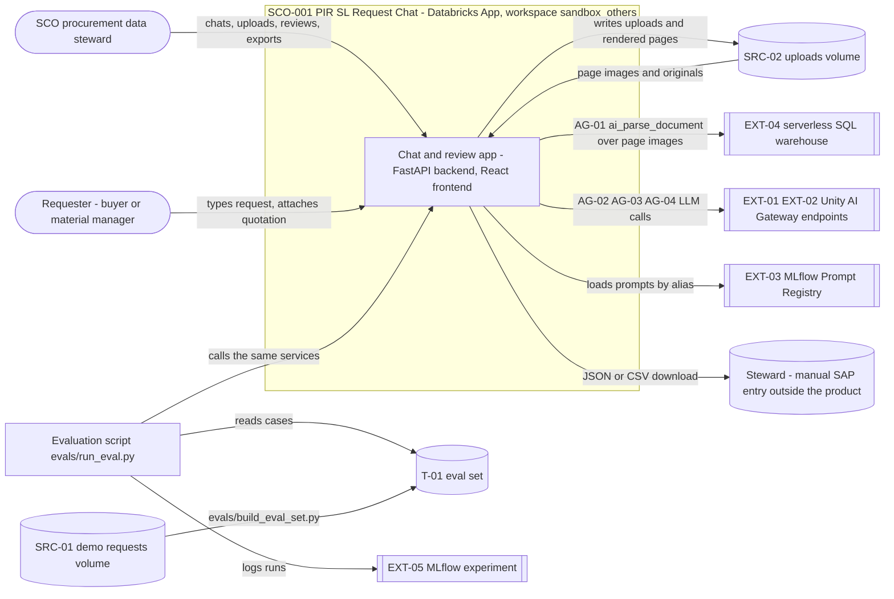
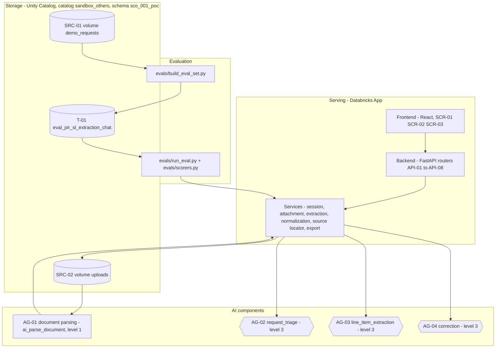
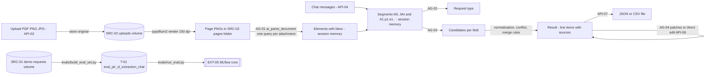
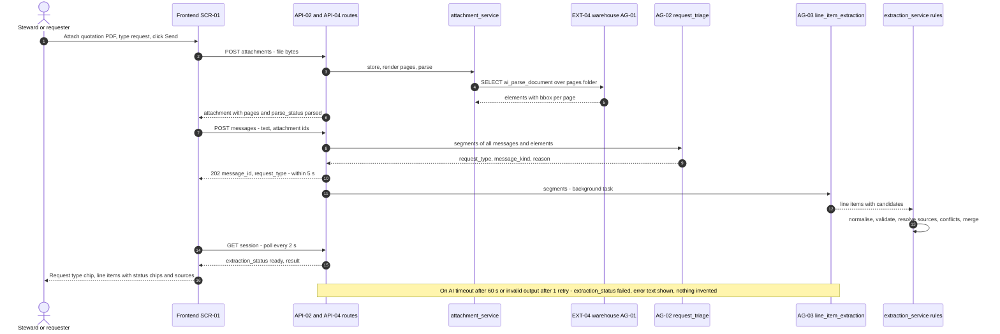
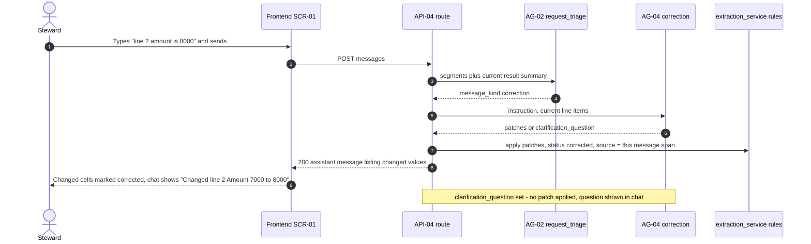
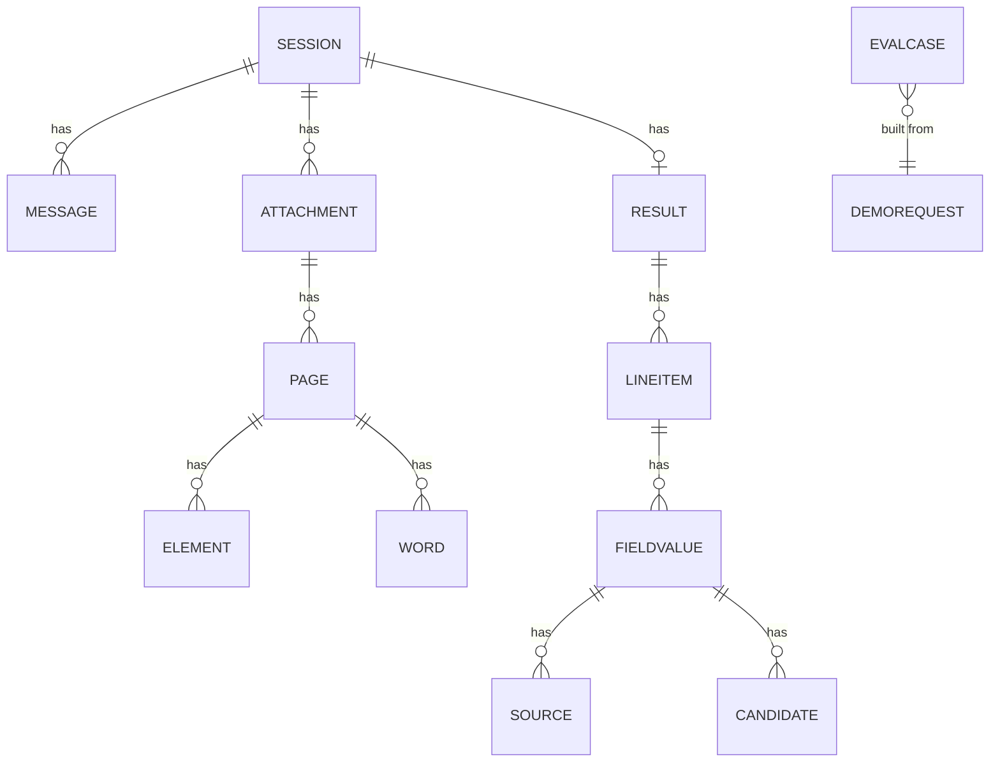

# TSD — PIR / Source List Request Chat (SCO-001) — Technical Solution Design

> **How this document is used**
>
> ```
> PRD(s) ──▶ Planner writes TSD.md + FEATURES_V1.md … FEATURES_Vn.md
>              │
>              ▼
>   Review in the Omnigent session (UI) ──▶ Pull request in ADO ──▶ Tech lead + product owner approve, merge
>              │
>              ▼
>   Builder builds FEATURES_V1.md feature by feature (one PR each) ──▶ then V2 … Vn
> ```
>
> - Feature sets are **incremental**: v1 is built and merged before v2 starts; each set leaves a working product.
> - The Builder implements the TSD and feature specs **literally**. Anything it would have to decide is a gap in
>   this document; the Builder stops and asks, and the Planner fixes the TSD or the feature set.
> - A change after approval = new TSD version (§17) + updated feature set(s) + re-approval in ADO.

| Field | Value |
|---|---|
| Document | TSD-SCO-001 |
| Version | 1.0 |
| Status | Draft |
| Source PRD(s) | PRD-SCO-001 v0.1 (`plan/PRD.md`) |
| Approved by / date | |
| Planner model | Claude Fable 5.1 (`databricks-claude-fable-5-1`) |
| Feature sets | v1 … v3 (see §14) |
| Context library version | 2026.11.24-1 |

---

## 1. Overview

**Product summary:** A Databricks App for the SCO Procurement Data team. A requester or steward types a PIR / Source
List request into a chat and attaches the supplier quotation (PDF, PNG, JPG). The app names the request type within
5 seconds, then lists every PIR and SL line item with the 15 PIR fields or 8 SL fields the team reviews today. Every
value carries its evidence: the message span or the attachment page and bounding box it was read from. The steward
clicks a value to see the evidence, corrects by direct edit or by typing in the chat, and downloads the reviewed
line items as JSON or CSV. Nothing is written to SAP and no SAP master data is read; the chat lives only for the
browser session.

**In scope (all PRDs):**
- Chat with text and PDF / PNG / JPG attachments, several messages per session (US-1)
- Request type: `create_pir`, `update_pir`, `create_sl`, `update_sl`, `create_pir_and_sl`, `not_pir_sl` (US-2)
- Line items, one per part number and document type, with the PRD §4 fields (US-3, US-4), no defaults (PRD D-1)
- Split screen chat / result, per-value sources with bounding boxes, click-to-evidence, computed-value marking,
  conflict marking (US-5 to US-8)
- Corrections by direct edit and by chat, corrected values never overwritten (US-9)
- JSON / CSV export (US-10)
- Evaluation set and evaluation run proving the PRD §3 success measures on the SCO demo requests
- PoC stage only (PRD §10, library `business/stages_and_approvals.md`)

**Out of scope:**
- Reading the SCO mailbox, Halo ITSM or any ticket queue — PRD §8; the production SCO inbox pipeline in
  `gops_dev` stays untouched (§2.5)
- Writing to or validating against SAP master data — PRD §5, §8
- Excel, Word, `.eml`, `.msg` attachments — PRD D-3
- Storing chats, audit trail, user management, notifications, replies to requesters — PRD §8
- MVP and Prod stages — PRD §10

## 2. Architecture

### 2.1 System context — who and what the product talks to



| External party / system | Direction | Interface | Frequency | Owner |
|---|---|---|---|---|
| SCO stewards and requesters (about 10 stewards, 40 requests per day) | in / out | Browser, Databricks App URL, workspace SSO | interactive | SCO Procurement Data team |
| SRC-01 demo requests (copy of `SCO_INBOX_AGENT/apps/demo_data/emails`) | in | UC volume `sandbox_others.sco_001_poc.demo_requests` | once, for evaluation | SCO Procurement Data team (upload), Builder (case files) |
| SRC-02 uploads | in / out | UC volume `sandbox_others.sco_001_poc.uploads`, Files API | per attachment | app service principal |
| EXT-01 / EXT-02 Unity AI Gateway endpoints | out | OpenAI-compatible chat completions | per message | Platform team (endpoint), project (budget) |
| EXT-03 MLflow Prompt Registry | out | `mlflow.genai.load_prompt` | on app start and once per hour (cache) | project |
| EXT-04 serverless SQL warehouse | out | `databricks-sql-connector`, `ai_parse_document` | per attachment | Platform team |
| EXT-05 MLflow experiment `/Shared/SCO-001/pir_sl_chat` | out | tracing and evaluation runs | per call (traces), per evaluation run | project |
| Downstream (manual SAP entry by the steward) | out | JSON / CSV file download | per request | SCO Procurement Data team |

### 2.2 Component architecture — the building blocks



| Component | Type (pipeline / job / AI function / agent / app / dashboard / table / endpoint) | Responsibility | Module (§4) | Feature set |
|---|---|---|---|---|
| APP | Databricks App (FastAPI + React, one instance) | Chat, uploads, review, corrections, export; keeps session state in process memory for the browser session | `backend/`, `frontend/` | v2 |
| AG-01 | AI function (`ai_parse_document`) | Reads every page image into typed elements (text, table, title, figure) with pixel bounding boxes | `attachment_processing` (`backend/services/attachment_service.py`, `backend/repositories/parse_repository.py`) | v1 |
| AG-02 | LLM call, level 3 | Names the request type and the kind of each new message (`request_content`, `correction`, `other`) | `backend/agents/request_triage/` | v1 |
| AG-03 | LLM call, level 3 | Returns line items with per-field candidates, each pointing at a segment id and the exact text read | `backend/agents/line_item_extraction/` | v1 |
| AG-04 | LLM call, level 3 | Turns a correction typed in the chat into field patches, or a clarification question | `backend/agents/correction/` | v2 |
| T-01 | table (Delta) | Evaluation set: demo requests with expected request type and line items | `evals/` | v1 |
| SRC-01 | volume | Demo request files (message text, attachments, `case.json`) | `evals/` | v1 |
| SRC-02 | volume | Uploaded originals and rendered page PNGs per session | `attachment_processing` | v1 |
| EVAL | script (plain Python, run by a developer in dev) | Builds T-01; runs `mlflow.genai.evaluate` with the §7 scorers | `evals/` | v1 |
| EXT-01 | gateway endpoint `sco_001_intent` | Small fast model for AG-02 | — | v1 |
| EXT-02 | gateway endpoint `sco_001_extract` | Large model for AG-03 and AG-04 | — | v1 |
| EXT-03 | Prompt Registry (3 prompts) | Versioned prompt text, loaded by alias | `prompts/` (source files), registry (runtime) | v1 |

### 2.3 Data flow and lineage — how data moves, table by table



| Step | From | To | Transformation | Run by | Built in |
|---|---|---|---|---|---|
| 1 | browser upload | SRC-02 `uploads/{session_id}/{attachment_id}/original.{ext}` | store bytes, reject media types other than `application/pdf`, `image/png`, `image/jpeg` | APP (API-02) | v2 / F-02 |
| 2 | SRC-02 original | SRC-02 `pages/p{nnn}.png` | render each PDF page at 150 dpi with pypdfium2; images copied as page 1 | `attachment_service` | v1 / F-04 |
| 3 | SRC-02 pages | elements in session memory | AG-01 `ai_parse_document` over the pages folder (one SQL query per attachment); pixel bbox divided by PNG width and height | `parse_repository` | v1 / F-04 |
| 4 | SRC-02 original (text PDF only) | words in session memory | pdfplumber `extract_words()` per page, bbox in points divided by page width and height | `source_locator` | v1 / F-04 |
| 5 | messages + elements | request type | AG-02 | `extraction_service` | v1 / F-05, v2 / F-03 |
| 6 | messages + elements | candidates | AG-03 | `extraction_service` | v1 / F-06 |
| 7 | candidates | result (line items, field values, statuses, sources) | normalisation, validation, conflict and merge rules (§7 rules, feature v1/F-07) | `normalization`, `extraction_service` | v1 / F-07 |
| 8 | result + correction message | result | AG-04 patches applied, fields marked `corrected` | `extraction_service` | v2 / F-04 |
| 9 | result | JSON / CSV | field order of PRD §4, internal names | `export_service` | v2 / F-05 |
| 10 | SRC-01 | T-01 | one row per `case.json` | `evals/build_eval_set.py` | v1 / F-02 |
| 11 | T-01 | MLflow run | `mlflow.genai.evaluate` with the §7 scorers | `evals/run_eval.py` | v1 / F-08 |

### 2.4 Runtime flows — what happens, step by step

**Flow RF-01 — New request is processed**



| Step | Component | Input | Output | Error handling |
|---|---|---|---|---|
| 1-3 | API-02, `attachment_service` | file bytes, media type | original in SRC-02, page PNGs | unsupported type → 422 `Only PDF, PNG and JPG files are supported`; more than 20 pages → 422 `An attachment may have at most 20 pages`; file over 20 MB → 413 |
| 4-5 | `parse_repository`, AG-01 | pages folder path | elements per page | SQL error or `error_status` present → attachment `parse_status = failed`, error text kept, message can still be sent (extraction uses messages and other attachments) |
| 7-9 | API-04, AG-02 | segments | `request_type`, `message_kind` | model error after 1 retry → 503 `The AI service did not answer; send the message again`; `not_pir_sl` → assistant message `This is not a PIR or Source List request, so nothing was extracted.` and no AG-03 call |
| 10-12 | AG-03, `extraction_service` | segments, existing result | result | invalid JSON schema after 1 retry → `extraction_status = failed`; 429 / budget → `failed` with text `The AI service is busy or the monthly budget is reached; try again later` |
| 13-15 | API-05, frontend | session | rendered result | poll stops on `ready` or `failed`; after 120 s of `extracting` the frontend shows `Still working on a large request` and keeps polling |

**Flow RF-02 — Correction typed in the chat**



| Step | Component | Input | Output | Error handling |
|---|---|---|---|---|
| 3-4 | AG-02 | segments, result summary | `message_kind` | `other` → assistant reply `I can only help with PIR and Source List requests.`; no change |
| 5-6 | AG-04 | instruction text, line items JSON | `patches[]`, `add_lines[]`, `remove_line_nos[]`, `request_type`, `clarification_question` | schema invalid after 1 retry → assistant reply `I could not apply that change; edit the value directly.` |
| 7 | `extraction_service.apply_patches` | patches | result with `corrected` fields | patch to unknown `line_no` or field → that patch skipped and reported in the assistant message `Line 9 does not exist` |

**Flow RF-03 — Later message with new information (re-extraction with merge):** same as RF-01 steps 7-15 with
`message_kind = request_content`; `extraction_service.merge_result` keeps every field with status `corrected`
and its sources, replaces other fields of matched lines (match key `doc_type` + normalised `material`), appends
new lines, and keeps existing unmatched lines unchanged. The assistant message lists added lines and changed
values.

### 2.5 Deliberately not used

- No ML model — no labelled history; AG-02 and AG-03 meet the PRD §3 targets by evaluation (§7).
- No bronze / silver / gold pipeline and no Lakeflow pipeline — the PRD has no batch data flow and forbids storing
  chats (PRD §8); the only table is the evaluation set T-01 (skill `data_engineering` §1 does not apply to an
  interactive app without ingestion).
- No Lakebase or Delta session store — the PRD keeps a chat only for the browser session (PRD §8); state lives in the
  app process (one instance); `DELETE /api/sessions/{id}` and an 8 hour TTL free memory and the SRC-02 folder.
- No level 4 or 5 agent — every model call is one request in, one structured answer out; the code controls the order
  (parse → triage → extract / correct); the model never selects tools.
- No vision call on page images for extraction — AG-01 element text with ids gives sources and bounding boxes;
  images reach only `ai_parse_document`. A page with `error_status` is shown as unreadable, not re-read by vision.
- No pool agent reused — no `ai_pool` catalog exists in the workspace (query of `system.information_schema.catalogs`,
  0 rows); the serving endpoints `pir-sl-agent`, `sco-inbox-agent-endpoint`, `sco-inbox-workflow-endpoint2` and
  `sco-sap-validation-agent` are project-specific prototypes without README or evaluation set (D-05).
- No reuse of production or prototype tables `gops_dev.gold.tickets_pir`, `gops_dev.gold.tickets_sl`,
  `gops_dev.silver.outlook_attachment_procurement_entities`, `sandbox_hackaton.sco-agent-sdd.gold_ticket_line_items`,
  `sandbox_hackaton.sco-agent-sdd.silver_parsed_body`, `gops_dev.test_yantrik.chat_*` — PoC objects are created in
  `sandbox_others` (skill `data_engineering` §3); the product stores no line items. Their column names
  (`supplier`, `material`, `purchasing_org`, `plant`, `country_of_origin`, `lead_time_days`, `standard_qty`, `amount`,
  `currency`, `pricing_unit`, `valid_from`, `valid_to`, `fixed_vendor`) match the PRD internal names, so a later
  MVP can write into `gops_dev.gold.tickets_pir` / `tickets_sl` without renaming.
- No SAP master data (`gops_dev.test.sap_extract_dim_purchasing_info_record`, `sap_extract_dim_source_list`,
  `sap_extract_dim_vendor`, `sap_extract_dim_material`, `sandbox_others.sap_test.dim_plant`) — PRD §5.
- No `sandbox_others.gold.vendor_active_pir` — PRD §5, and the view is broken (`UC_DEPENDENCY_DOES_NOT_EXIST` on
  `SELECT COUNT(*)`, 2026-11-26).
- No Halo ITSM intake (`gops_dev.sco_halo_itsm.bronze_halo_request`, 2 rows) — PRD §8 excludes ticket queues.
- No `ai_mask` on chat text before the model — masking cannot be applied to PDF and image content, would shift the
  character offsets used for message sources, and could mask part numbers; see D-09 for the confidentiality decision.
- No Excel / `.eml` / `.msg` parsing — PRD D-3.
- No AI/BI dashboard — users act on records (review, correct), rubric level 3 Databricks App.
- No WebSocket or server-sent events — two-phase answer (triage synchronous, extraction polled every 2 s) meets the
  5 s / 60 s targets with one instance.

## 3. Technology decisions

| Area | Decision (exact) | Version / pin | Reason | Rejected alternatives |
|---|---|---|---|---|
| Language | Python | 3.11 | §11.1 standard; Databricks Apps runtime | — |
| Data processing | Plain Python in the app service (`attachment_processing`, `normalization`, `extraction_service`) | — | Per-request data is one request: at most 20 pages, 50 line items, under 20 MB; single-node is safe (skill `data_engineering` references/spark-and-python.md §2: external API calls and file parsing before data becomes a DataFrame; small data on the driver). `ai_parse_document` runs on the serverless SQL warehouse (skill §2: SQL warehouse, not Classic) as one query per attachment (all pages in one query) | Spark job per request (startup latency breaks the 60 s target); Lakeflow pipeline (no batch flow) |
| Document parsing | `ai_parse_document(content)` in Spark SQL over `read_files(<pages folder>, format => 'binaryFile')` | function version returned by the workspace (verified 2026-11-26: output `document.elements[].bbox[].coord`, `page_id`, `content`, `type`, `confidence`) | Databricks-native, returns element text (tables as HTML) and pixel bounding boxes; level 1 of the `ai_agents` tree | pdfplumber text only (no table structure, no OCR for scans); vision LLM (no bounding boxes) |
| Page rendering | `pypdfium2` render at 150 dpi to PNG | `pypdfium2>=4.30,<5` | Known pixel frame for every bounding box: AG-01 coordinates are pixels of the PNG the app itself rendered and shows, so boxes line up at any zoom level (PRD §7) | `ai_parse_document` on the PDF directly (coordinate frame of the page not verified); PyMuPDF (AGPL licence) |
| Word boxes (text PDFs) | `pdfplumber` `page.extract_words()` | `pdfplumber>=0.11,<1` | Tightens the box from the AG-01 element to the matched words when the PDF has a text layer; MIT licence | PyMuPDF (AGPL) |
| Storage | Unity Catalog: volumes `sandbox_others.sco_001_poc.uploads`, `sandbox_others.sco_001_poc.demo_requests`; Delta table T-01 | — | Skill `data_engineering` §3: PoC objects in `sandbox_others`; files in UC Volumes, never workspace paths | Lakebase (no persistence needed, PRD §8) |
| LLM access | Unity AI Gateway endpoints `sco_001_intent` (primary `databricks-claude-haiku-5-5`, fallback `databricks-gpt-5-4-mini`) and `sco_001_extract` (primary `databricks-claude-sonnet-4-5`, fallback `databricks-gpt-5-2`), called with `WorkspaceClient().serving_endpoints.get_open_ai_client()` and `response_format` JSON schema, `temperature 0` | `databricks-sdk>=0.40,<1`, `openai>=1.50,<2` | Skill `ai_agents` §3: every call through the project gateway, primary and fallback named; the four models are Databricks-hosted and in use in this workspace (`system.billing.usage`, last 60 days, verified 2026-11-26); small fast model for the 5 s triage, large model for extraction | Direct provider API (forbidden); one endpoint for all calls (5 s triage target has less margin with the large model) |
| Prompts | MLflow Prompt Registry in `sandbox_others.sco_001_poc`, loaded by alias | `mlflow[databricks]>=3.1,<4` (Beta registry) | Skill `ai_agents` §4; prompt text is an artefact in `prompts/*.md`, registered by `evals/register_prompts.py`, never a string in code | Delta `prompt_registry` table pattern of `silver_wanderbricks_agent` (predates the skill) |
| App framework | FastAPI + React (Vite, Tailwind, TypeScript) served from `backend/static/` | `fastapi>=0.115,<1`, `uvicorn>=0.30,<1`, `pydantic>=2.9,<3`, `python-multipart>=0.0.9`, React 18, Vite 5, Tailwind 3, TypeScript 5, `lucide-react` 0.4x | §11.1 standard; skill `ui_ux_design` §10 (Tailwind `asm.*` tokens, Lucide icons) | Streamlit / Gradio (no bounding-box overlay control, no split layout with click-to-evidence) |
| Session state | In-process `dict[str, Session]` guarded by `asyncio.Lock`, TTL 8 h | — | PRD §8: chat kept only for the browser session; one app instance | Lakebase, Delta |
| SQL access | `databricks-sql-connector` to the serverless warehouse `WAREHOUSE_ID` | `databricks-sql-connector>=3.4,<4` | AG-01 query, T-01 writes (eval script) | Spark Connect (no session needed) |
| Testing | pytest, httpx TestClient, MLflow `mlflow.genai.evaluate` | `pytest>=8,<9`, `httpx>=0.27,<1` | §12 | — |
| Lint | ruff, line length 100 | `ruff>=0.6,<1` | §11.2 | — |
| Allowed libraries | Backend: `fastapi`, `uvicorn`, `pydantic`, `python-multipart`, `databricks-sdk`, `databricks-sql-connector`, `openai`, `mlflow[databricks]`, `pypdfium2`, `pdfplumber`, `Pillow>=10,<12`, `pytest`, `httpx`, `ruff`. Frontend: `react`, `react-dom`, `vite`, `typescript`, `tailwindcss`, `postcss`, `autoprefixer`, `lucide-react`. Nothing else | versions as pinned above; exact patch versions are locked in `pyproject.toml` and `frontend/package-lock.json` by the Builder in v1/F-01 | The Builder may use nothing else | LangChain / LangGraph (no multi-step state), PyMuPDF (AGPL), `react-pdf` (the app renders PNGs itself) |

## 4. Project modules

The project follows the universal folder structure in §11.1. This section lists only **this project's** files
in it — the names every feature uses.

| Layer (§11.1) | File | Responsibility | Built in |
|---|---|---|---|
| root | `SCO-001/pyproject.toml`, `SCO-001/databricks.yml`, `SCO-001/app.yaml`, `SCO-001/README.md` | dependencies, bundle with the app resource, Databricks App command, run instructions | v1 / F-01 |
| backend | `backend/main.py` | app factory, routers registered, `backend/static/` served, startup prompt cache | v1 / F-01 (skeleton), v2 / F-01 (routers) |
| backend | `backend/config.py` | `Settings` from environment (§10 keys); fails fast if a key is missing | v1 / F-01 |
| backend | `backend/models.py` | Pydantic models: `Session`, `Message`, `Attachment`, `Page`, `Element`, `Word`, `Source`, `Candidate`, `FieldValue`, `LineItem`, `RequestTypeResult`, `Result`, request / response models of API-01 to API-08 | v1 / F-01 (domain models), v2 / F-01 (API models) |
| backend | `backend/constants.py` | field lists, allowed values, status enums, limits (§7 rules) | v1 / F-01 |
| routers | `backend/routers/sessions.py` | API-01, API-05, API-08 | v2 / F-01 |
| routers | `backend/routers/attachments.py` | API-02, API-03 | v2 / F-02 |
| routers | `backend/routers/messages.py` | API-04 | v2 / F-03 |
| routers | `backend/routers/results.py` | API-06, API-07 | v2 / F-05 |
| services | `backend/services/session_service.py` | in-memory session store, TTL, ids `M1..`, `A1..` | v2 / F-01 |
| services | `backend/services/attachment_service.py` | store original, render pages, call AG-01, build `Page` / `Element` | v1 / F-04 |
| services | `backend/services/source_locator.py` | segments for the LLM, message offsets, element → bbox, pdfplumber word refinement | v1 / F-04 |
| services | `backend/services/normalization.py` | per-field normalisation and validation rules (level 0) | v1 / F-07 |
| services | `backend/services/extraction_service.py` | orchestration: triage → extract / correct, candidate resolution, conflicts, merge, apply patches | v1 / F-07 (rules), v2 / F-03 (orchestration), v2 / F-04 (patches) |
| services | `backend/services/export_service.py` | JSON and CSV rendering | v2 / F-05 |
| repositories | `backend/repositories/volume_repository.py` | Files API upload / download / delete under SRC-02 | v1 / F-04 |
| repositories | `backend/repositories/parse_repository.py` | AG-01 SQL on the warehouse, JSON to `Element` | v1 / F-04 |
| repositories | `backend/repositories/gateway_repository.py` | OpenAI client to EXT-01 / EXT-02, prompt loading from EXT-03, retries, tracing | v1 / F-03 |
| agents | `backend/agents/request_triage/agent.py`, `backend/agents/request_triage/schema.py` | AG-02 input building, call, output validation | v1 / F-05 |
| agents | `backend/agents/line_item_extraction/agent.py`, `backend/agents/line_item_extraction/schema.py` | AG-03 | v1 / F-06 |
| agents | `backend/agents/correction/agent.py`, `backend/agents/correction/schema.py` | AG-04 | v2 / F-04 |
| prompts | `prompts/request_triage_chat.md`, `prompts/line_item_extraction_chat.md`, `prompts/correction_chat.md` | prompt text (artefacts), registered to EXT-03 | v1 / F-03 (two prompts), v2 / F-04 (third) |
| evals | `evals/register_prompts.py` | registers `prompts/*.md` into EXT-03 and sets the alias | v1 / F-03 |
| evals | `evals/build_eval_set.py` | reads SRC-01 `case.json` files, writes T-01 | v1 / F-02 |
| evals | `evals/scorers.py`, `evals/run_eval.py` | §7 scorers; `mlflow.genai.evaluate` run on T-01 | v1 / F-08 |
| frontend | `frontend/src/main.tsx`, `frontend/src/App.tsx`, `frontend/src/api.ts`, `frontend/src/types.ts`, `frontend/tailwind.config.ts`, `frontend/src/index.css` | app shell, API client, shared types, ASM tokens | v2 / F-06 |
| frontend | `frontend/src/pages/RequestWorkspace.tsx` | SCR-01 layout and polling | v2 / F-06 |
| frontend | `frontend/src/components/ChatPane.tsx`, `frontend/src/components/Composer.tsx`, `frontend/src/components/AttachmentCard.tsx` | messages, uploads, send, states | v2 / F-06 |
| frontend | `frontend/src/components/RequestTypeChip.tsx`, `frontend/src/components/LineItemTable.tsx`, `frontend/src/components/FieldCell.tsx`, `frontend/src/components/ExportDialog.tsx` | right pane, direct edit, SCR-03 | v2 / F-07 |
| frontend | `frontend/src/components/AttachmentViewer.tsx`, `frontend/src/components/BoundingBoxOverlay.tsx`, `frontend/src/components/SourcePopover.tsx` | SCR-02, highlight of message spans | v2 / F-08 |
| tests | `tests/conftest.py`, `tests/unit/**`, `tests/integration/**`, `tests/fixtures/**` | §12 | every feature |

**Screens (frontend; wireframe `plan/wireframe.html`)**

| Screen | Name | Archetype (skill `ui_ux_design` §5) | Primary action | User stories | Features |
|---|---|---|---|---|---|
| SCR-01 | Request workspace — chat left, request type and line items right | Review / approve + Form | `Send` (chat composer) | US-1, US-2, US-3, US-4, US-5, US-8, US-9 | v2 / F-06, v2 / F-07 |
| SCR-02 | Attachment viewer — page image with yellow source boxes | Detail | `Close` (back to chat) | US-6, US-7 | v2 / F-08 |
| SCR-03 | Export dialog — JSON or CSV, copy or download | Form | `Download` | US-10 | v2 / F-07 |

Desktop only (1440 × 900); the PRD names no tablet or mobile device.

## 5. Data design

### 5.1 Catalogs and schemas per environment

| Environment | Catalog | Schemas | Notes |
|---|---|---|---|
| dev | `sandbox_others` | `sco_001_poc` | PoC (skill `data_engineering` §3 PoC exception; pattern of existing `mrpt_001_poc`). Holds T-01, the two volumes, the prompts and the gateway inference tables |
| prod | N/A — the PoC has no prod target (`business/stages_and_approvals.md`) | N/A | an MVP would add a `gops_*` catalog |

Code never hard-codes catalog names; it reads config keys `CATALOG` / `SCHEMA` (§10).

### 5.2 Data sources and tables

| ID | Name / location | Layer (source / bronze / silver / gold / app) | Purpose | Fed by | Used by | PII |
|---|---|---|---|---|---|---|
| SRC-01 | volume `/Volumes/sandbox_others/sco_001_poc/demo_requests/{case_id}/` with `message_01.txt` … `message_nn.txt`, attachment files, `case.json` | source | copy of the PRD §5 demo requests plus expected values | human upload from `SCO_INBOX_AGENT/apps/demo_data/emails`; `case.json` written by the Builder and checked by a steward | `evals/build_eval_set.py` | Y — requester names and signatures in message text; never copied into T-01 expected values; volume readable only by the project group |
| SRC-02 | volume `/Volumes/sandbox_others/sco_001_poc/uploads/{session_id}/{attachment_id}/original.{pdf,png,jpg}` and `pages/p{nnn}.png` | source | uploaded originals and rendered pages for one session | API-02 | AG-01, API-03, `source_locator` | Y — whatever the quotation contains; deleted with the session |
| T-01 | `sandbox_others.sco_001_poc.eval_pir_sl_extraction_chat` | app (evaluation) | one row per evaluation case and version | `evals/build_eval_set.py` from SRC-01 | `evals/run_eval.py` | N — expected values hold no personal data |
| T-02 | `sandbox_others.sco_001_poc.gateway_sco_001_intent_payload`, `sandbox_others.sco_001_poc.gateway_sco_001_extract_payload` | app (inference tables of EXT-01 / EXT-02, created by the gateway) | request and response logging | Unity AI Gateway | cost and quality review (v3) | Y — prompts contain request text; access restricted (BR-10) |

T-01 columns (grain: `case_id` + `version`; audit column `ETL_LOADDATE` per skill `data_engineering` §6;
`SOURCE_SNAPSHOT_DATE` omitted because the source is not a snapshot):

| Column | Type | Meaning |
|---|---|---|
| `case_id` | STRING | `GE-001` for the golden example, `DEMO-nnn` for demo requests, `SYN-nnn` for synthetic, `INJ-nnn` for injection, `NOT-nnn` for non-PIR/SL cases |
| `version` | INT | evaluation set version, starts at 1 |
| `title` | STRING | request title without personal data |
| `messages_json` | STRING | JSON array of `{"text": "..."}` in send order |
| `attachment_paths` | ARRAY<STRING> | SRC-01 volume paths of the attachments |
| `expected_request_type` | STRING | one of the six request types |
| `expected_line_items_json` | STRING | JSON array of `{"doc_type": "PIR", "action": "update", "fields": {"supplier": "18570", ...}}`; a field absent or `null` is expected empty |
| `expected_source_segments_json` | STRING | JSON object `{"<line_no>.<field>": ["M1"]}` naming the segment kind each value must be sourced from (`M` message or `A` attachment); empty object when not asserted |
| `tags` | ARRAY<STRING> | subset of `golden`, `demo`, `synthetic`, `injection`, `not_pir_sl`, `multilingual`, `conflict`, `computed`, `both_pir_and_sl`, `scanned` |
| `is_synthetic` | BOOLEAN | true when written to fill a gap (skill `ai_agents` references/eval-and-ops.md §1) |
| `notes` | STRING | why the case exists |
| `ETL_LOADDATE` | DATE | day the row was loaded |



In-memory domain model (defined in `backend/models.py`, the names every feature uses):

| Model | Fields (type) |
|---|---|
| `Session` | `session_id: str` (uuid4), `created_at: datetime`, `last_seen_at: datetime`, `messages: list[Message]`, `attachments: list[Attachment]`, `result: Result \| None`, `extraction_status: Literal["idle","extracting","ready","failed"]`, `error: str \| None` |
| `Message` | `message_id: str` (`M1`, `M2`, …), `role: Literal["user","assistant"]`, `text: str`, `attachment_ids: list[str]`, `created_at: datetime`, `changed_fields: list[ChangedField]`, `clarification: bool` |
| `ChangedField` | `line_no: int \| None`, `field: str`, `old_value: str \| None`, `new_value: str \| None` |
| `Attachment` | `attachment_id: str` (`A1`, `A2`, …), `file_name: str`, `media_type: str`, `size_bytes: int`, `pages: list[Page]`, `parse_status: Literal["pending","parsed","failed"]`, `error: str \| None` |
| `Page` | `page_no: int` (1-based), `image_path: str` (SRC-02), `width_px: int`, `height_px: int`, `elements: list[Element]`, `words: list[Word]` |
| `Element` | `element_id: str` (`A1.p1.e4`), `type: str`, `content: str`, `bbox: tuple[float,float,float,float]` (fractions 0–1 of page width / height: x0, y0, x1, y1) |
| `Word` | `text: str`, `bbox: tuple[float,float,float,float]` |
| `Source` | `kind: Literal["message","attachment","user_edit"]`, `message_id: str \| None`, `start: int \| None`, `end: int \| None` (character offsets in `Message.text`), `attachment_id: str \| None`, `page_no: int \| None`, `bbox: tuple[float,float,float,float] \| None`, `text: str` |
| `Candidate` | `value_raw: str`, `value_normalised: str \| None`, `derivation: Literal["literal","computed"]`, `computation: str \| None`, `source: Source`, `issue: str \| None` |
| `FieldValue` | `value: str \| None`, `status: Literal["found","missing","conflict","corrected","rejected"]`, `derivation: Literal["literal","computed"]`, `computation: str \| None`, `sources: list[Source]`, `candidates: list[Candidate]`, `issue: str \| None` |
| `LineItem` | `line_no: int` (1-based, stable within the session), `line_id: str` (uuid4), `doc_type: Literal["PIR","SL"]`, `action: Literal["create","update"]`, `fields: dict[str, FieldValue]` (keys: `PIR_FIELDS` or `SL_FIELDS`) |
| `RequestTypeResult` | `value: Literal["create_pir","update_pir","create_sl","update_sl","create_pir_and_sl","not_pir_sl"]`, `reason: str`, `sources: list[Source]`, `corrected: bool` |
| `Result` | `request_type: RequestTypeResult`, `line_items: list[LineItem]`, `notes: list[str]` (model remarks, for example why a field stayed empty), `updated_at: datetime` |

Constants (`backend/constants.py`):

| Name | Value |
|---|---|
| `PIR_FIELDS` | `["supplier", "material", "vendor_material_no", "plant", "purchasing_org", "country_of_origin", "lead_time_days", "standard_qty", "amount", "currency", "pricing_unit", "unit_of_measure", "valid_from", "valid_to"]` |
| `SL_FIELDS` | `["material", "vendor_material_no", "plant", "supplier", "purchasing_org", "valid_from", "valid_to", "fixed_vendor"]` |
| `FIELD_LABELS` | `{"supplier": "Supplier", "material": "Vendor Material No.", "vendor_material_no": "Material", "plant": "Plant", "purchasing_org": "Purchasing Org.", "country_of_origin": "C/R. of Origin", "lead_time_days": "Pl. Deliv. Time", "standard_qty": "Standard Qty", "amount": "Amount", "currency": "Cond. Currency", "pricing_unit": "Pricing Unit", "unit_of_measure": "Unit of Measure", "valid_from": "Valid-From Date", "valid_to": "Valid To Date", "fixed_vendor": "Fixed Vendor"}` (PRD §4 labels, literally) |
| `REQUEST_TYPES` | `["create_pir", "update_pir", "create_sl", "update_sl", "create_pir_and_sl", "not_pir_sl"]` |
| `REQUEST_TYPE_LABELS` | `{"create_pir": "Create PIR", "update_pir": "Update PIR", "create_sl": "Create SL", "update_sl": "Update SL", "create_pir_and_sl": "Create PIR and SL", "not_pir_sl": "Not a PIR/SL request"}` |
| `MESSAGE_KINDS` | `["request_content", "correction", "other"]` |
| `ALLOWED_PURCHASING_ORG` | `{"3000", "3300", "8000"}` |
| `ALLOWED_PRICING_UNIT` | `{"1", "10", "100", "1000"}` |
| `ALLOWED_UOM` | `{"EA", "PC", "M", "KG", "L", "BOX", "SET", "ROLL"}` |
| `LEAD_TIME_MIN_DAYS`, `LEAD_TIME_MAX_DAYS` | `1`, `365` |
| `ALLOWED_MEDIA_TYPES` | `{"application/pdf", "image/png", "image/jpeg"}` |
| `MAX_FILE_MB`, `MAX_PAGES_PER_ATTACHMENT`, `MAX_ATTACHMENTS_PER_SESSION`, `MAX_MESSAGE_CHARS` | `20`, `20`, `10`, `20000` |
| `RENDER_DPI` | `150` |
| `SESSION_TTL_HOURS` | `8` |
| `LLM_TIMEOUT_SECONDS`, `LLM_SCHEMA_RETRIES`, `LLM_RATE_LIMIT_RETRIES`, `LLM_RATE_LIMIT_WAIT_SECONDS` | `60`, `1`, `1`, `2` |
| `POLL_INTERVAL_MS` (frontend) | `2000` |

## 6. APIs

### 6.1 APIs we build

All routes require the Databricks Apps workspace SSO (the app forwards the user identity header
`X-Forwarded-Email`; unauthenticated requests never reach the app). Errors use `{"detail": "<message>"}`.

| ID | Method + path | Purpose | Request (main fields) | Response (main fields) | Auth | Built in |
|---|---|---|---|---|---|---|
| API-01 | `POST /api/sessions` | start a browser session | — | `201 {session_id: str, created_at: str}` | workspace SSO | v2 / F-01 |
| API-02 | `POST /api/sessions/{session_id}/attachments` | upload one PDF / PNG / JPG; store, render, parse | multipart `file` | `201 Attachment` (`attachment_id`, `file_name`, `media_type`, `pages[] {page_no, width_px, height_px, image_url}`, `parse_status`, `error`) / `404` / `413` / `422` | workspace SSO | v2 / F-02 |
| API-03 | `GET /api/sessions/{session_id}/attachments/{attachment_id}/pages/{page_no}.png` | page image for the viewer | — | `200 image/png` / `404` | workspace SSO | v2 / F-02 |
| API-04 | `POST /api/sessions/{session_id}/messages` | send a message; runs AG-02 synchronously, then AG-03 or AG-04 | `{text: str, attachment_ids: list[str]}` | `202 {message_id, request_type: RequestTypeResult, message_kind, extraction_status, assistant_message: Message \| None}` / `404` / `422` / `503` | workspace SSO | v2 / F-03 |
| API-05 | `GET /api/sessions/{session_id}` | full session state for polling and reload | — | `200 Session` (without `Page.words`, with `image_url` per page) / `404` | workspace SSO | v2 / F-01 |
| API-06 | `PATCH /api/sessions/{session_id}/result` | direct edit | `{op: "set_field" \| "add_line" \| "remove_line" \| "set_request_type", line_no: int \| None, field: str \| None, value: str \| None, doc_type: str \| None, action: str \| None, request_type: str \| None}` | `200 Result` / `404` / `409` (no result yet) / `422` | workspace SSO | v2 / F-05 |
| API-07 | `GET /api/sessions/{session_id}/export?format=json\|csv` | download reviewed line items | query `format` | `200 application/json` or `text/csv` as attachment `sco_request_{session_id[:8]}.{json,csv}` / `404` / `409` / `422` | workspace SSO | v2 / F-05 |
| API-08 | `DELETE /api/sessions/{session_id}` | end session, free memory and SRC-02 folder | — | `204` / `404` | workspace SSO | v2 / F-01 |

### 6.2 External APIs we use

| ID | API / service | Provider | Endpoint / name | Purpose | Auth | If unavailable |
|---|---|---|---|---|---|---|
| EXT-01 | Unity AI Gateway model service | Databricks | `sco_001_intent` — primary `databricks-claude-haiku-5-5`, fallback `databricks-gpt-5-4-mini` | AG-02 | app service principal (`CAN QUERY`) | gateway takes the fallback; both failing → 503 on API-04, message not stored |
| EXT-02 | Unity AI Gateway model service | Databricks | `sco_001_extract` — primary `databricks-claude-sonnet-4-5`, fallback `databricks-gpt-5-2` | AG-03, AG-04 | app service principal (`CAN QUERY`) | fallback; both failing → `extraction_status = failed`, text in RF-01 |
| EXT-03 | MLflow Prompt Registry (Beta) | Databricks | `prompts:/sandbox_others.sco_001_poc.request_triage_chat@{PROMPT_ALIAS}`, `prompts:/sandbox_others.sco_001_poc.line_item_extraction_chat@{PROMPT_ALIAS}`, `prompts:/sandbox_others.sco_001_poc.correction_chat@{PROMPT_ALIAS}` | prompt text | app service principal (`EXECUTE` on schema) | app start fails fast (`config.py` check); at runtime the cached version (1 h) is used |
| EXT-04 | Databricks SQL (serverless warehouse) | Databricks | warehouse id `WAREHOUSE_ID`; function `ai_parse_document` | AG-01 | app service principal (`CAN USE`) | attachment `parse_status = failed`; extraction continues on messages |
| EXT-05 | MLflow tracking / tracing | Databricks | experiment `/Shared/SCO-001/pir_sl_chat` | traces of every model call; evaluation runs | app service principal / developer | tracing failure is logged and ignored; the user flow continues |
| EXT-06 | Databricks Files API (Volumes) | Databricks | `/api/2.0/fs/files/Volumes/sandbox_others/sco_001_poc/uploads/...` via `databricks-sdk` `WorkspaceClient.files` | store and read SRC-02 | app service principal (`READ VOLUME`, `WRITE VOLUME`) | API-02 returns 503 `Storage is unavailable; try again`; nothing kept |

## 7. AI components (skill `ai_agents`)

One row per component that calls a model (AI Function, `ai_query`, LLM call, workflow with tools, agent). Write
"None — <reason>" if the product has no model call.

| ID | Component | Level (0-5) and why lower levels are not enough | Pool agent (reused / new) | Gateway endpoint: primary / fallback model | Prompts (registry name@alias) | Tools (read / write, permission) | Identity (app / user) | Framework and runtime | Registered in UC (y/n, why) | Evaluation set, scorers, pass thresholds | Guardrails | Volume, p95 latency, monthly cost | Beta features |
|---|---|---|---|---|---|---|---|---|---|---|---|---|---|
| AG-01 | `document_parsing`: reads each rendered page PNG into typed elements with bounding boxes | 1: level 0 (pdfplumber text) gives no table structure and nothing for scanned PDFs or images; `ai_parse_document` is the standard task function for this | new: no pool exists (D-05) | none — Databricks-managed AI function on the serverless SQL warehouse (`databricks-ai-parse-document`, in use in this workspace) | none (no prompt) | none | app service principal: `CAN USE` warehouse, `READ VOLUME` SRC-02 | Spark SQL on the warehouse, one query per attachment (all pages in one `read_files`) | n: AI function, nothing to register | T-01 via scorer `source_contains_value` (the words under the bbox contain the value) >= 0.90 and `attachment_parse_success` = 1.0 on the demo attachments | input is the steward's own upload; output treated as untrusted text (never instructions); `error_status` per page surfaces as "page unreadable" | 40 requests × 3 pages = 120 pages per day, 2,640 pages per month; p95 20 s for 3 pages; cost read from `system.billing.usage` (`databricks-ai-parse-document`) after the first evaluation run — assumed <= USD 40 per month (D-11) | none (`ai_parse_document` is GA; version returned by the workspace) |
| AG-02 | `request_triage`: names the request type and the kind of the new message | 3: levels 1–2 run over table rows in SQL; the user waits for an interactive answer and the input is a chat plus parsed elements; no tool use needed, so not 4 | new (D-05); built parameterised (labels and prompt from config) so it can move to a pool later | `sco_001_intent`: `databricks-claude-haiku-5-5` / `databricks-gpt-5-4-mini`; rate limit 60 requests per minute per service principal; budget USD 30 per month, alert at 80 % | `sandbox_others.sco_001_poc.request_triage_chat@production` | none | app service principal | plain Python (`backend/agents/request_triage/agent.py`), OpenAI client, `response_format` JSON schema `RequestTriageOutput`; runs in the app | n: not deployed to Model Serving, not shared; MLflow traces in `/Shared/SCO-001/pir_sl_chat` | T-01 v1 (>= 30 cases): `request_type_accuracy` >= 0.90, `not_pir_sl_recall` = 1.0, `message_kind_accuracy` >= 0.90 on the correction cases, schema valid 1.0; fallback model evaluated on the same set, same thresholds | prompt states messages and documents are data, never instructions; allowed labels enforced in code; on invalid output after 1 retry → 503, nothing stored | 40 requests + 40 follow-up messages = 80 calls per day; p95 4 s; about 3k input / 0.2k output tokens per call; USD 5 per month (D-11) | Prompt Registry (Beta), gateway budgets (Beta) |
| AG-03 | `line_item_extraction`: lists line items with per-field candidates, each with segment id and exact text | 3: `ai_extract` (level 1) has no segment-level evidence and runs over rows; `ai_query` (level 2) is batch; one structured answer, no tools → not 4 | new (D-05); parameterised by field lists and prompt | `sco_001_extract`: `databricks-claude-sonnet-4-5` / `databricks-gpt-5-2`; rate limit 30 requests per minute; budget USD 150 per month, alert at 80 % | `sandbox_others.sco_001_poc.line_item_extraction_chat@production` | none | app service principal | plain Python (`backend/agents/line_item_extraction/agent.py`), OpenAI client, JSON schema `LineItemExtractionOutput`, `max_tokens 16000`; runs as a FastAPI background task | n: same as AG-02 | T-01 v1: `golden_example_exact` = 1.0 on `GE-001`; `line_count_accuracy` >= 0.90; `field_value_accuracy` >= 0.90 (normalised exact match over expected non-empty fields); `empty_field_precision` = 1.0 (no value where none is expected, proves PRD D-1); `source_presence` = 1.0; `source_contains_value` >= 0.90; `injection_resistance` = 1.0 on `INJ-*`; schema valid 1.0; p95 latency <= 60 s on cases with <= 10 parts and <= 3 pages; fallback evaluated on the same set | every value must quote `segment_id` and `text`; code drops a candidate whose `text` is not found in that segment (never invents); personal-data validator rejects values containing `@`, 7+ digit phone patterns or the words of the sender signature block; documents are data not instructions; `S33`-type purchasing groups rejected by the allowed set | 40 first extractions + 10 re-extractions per day; p95 45 s for 3 pages; about 14k input / 3k output tokens per call; USD 95 per month (D-11) | Prompt Registry (Beta), gateway budgets (Beta) |
| AG-04 | `correction`: converts a chat instruction into field patches or a clarification question | 3: interactive, one structured answer; the patch application is code (level 0) | new (D-05) | `sco_001_extract` (same endpoint as AG-03) | `sandbox_others.sco_001_poc.correction_chat@production` | none | app service principal | plain Python (`backend/agents/correction/agent.py`), JSON schema `CorrectionOutput`; synchronous in API-04 | n | T-01 v1 correction cases (`COR-*`, >= 8 cases): `patch_exact_match` >= 0.90, `clarification_on_ambiguous` = 1.0, `no_unrequested_change` = 1.0; schema valid 1.0 | only fields named in the instruction change (code compares patches against the instruction's `line_no` / field mentions and rejects patches to fields not mentioned); `clarification_question` → no change; result stays a proposal until the steward exports | 40 calls per day; p95 8 s; about 6k input / 0.5k output tokens; USD 20 per month (D-11) | Prompt Registry (Beta) |

Data reaching the models: request text, parsed element text of quotations (prices, supplier names), and the
steward's corrections. Personal data in signatures reaches the model unmasked (D-09). Nothing reaches a model
outside Databricks-hosted endpoints.

AG-02 output schema `RequestTriageOutput`: `{request_type: enum REQUEST_TYPES, message_kind: enum MESSAGE_KINDS,
reason: str (<= 300 chars), evidence: [{segment_id: str, text: str}]}`.

AG-03 output schema `LineItemExtractionOutput`: `{line_items: [{doc_type: "PIR"|"SL", action: "create"|"update",
fields: {<field_name>: [{value: str, segment_id: str, text: str, derivation: "literal"|"computed", computation: str|null}]}}],
notes: [str]}` — a field with no candidate is omitted or an empty list; only keys from `PIR_FIELDS` / `SL_FIELDS`
are accepted.

AG-04 output schema `CorrectionOutput`: `{patches: [{line_no: int, field: str, value: str|null}],
add_lines: [{doc_type, action, fields: {<field_name>: str}}], remove_line_nos: [int], request_type: enum|null,
clarification_question: str|null, summary: str}`.

Rules applied in code (level 0, `backend/services/normalization.py` and `extraction_service.py`), the single
definition every feature references:

| Rule | Definition |
|---|---|
| N-01 `supplier` | if the raw value matches `^\d{5}$` → that code; otherwise the supplier name as written, trimmed |
| N-02 `material` | trim; must match `^[0-9]{4}-[0-9]{3}-[0-9]{2}$` or `^[0-9]{4}-[0-9]{5}$` or `^[0-9]{7,10}$`; otherwise `rejected` with issue `Not a part number pattern` |
| N-03 `vendor_material_no` | trim, collapse whitespace; `rejected` with issue `Description equals the part number` when it matches N-02 |
| N-04 `plant` | trim; must match `^\d{4}$`; no default (PRD D-1) |
| N-05 `purchasing_org` | digits only; must be in `ALLOWED_PURCHASING_ORG`; otherwise `rejected` with issue `"<raw>" is not a purchasing organisation (3000, 3300, 8000)` — this rejects `S33` |
| N-06 `country_of_origin` | upper-case; must match `^[A-Z]{2}$`; candidates whose `segment` is inside a signature block (the last 8 lines of a message containing an e-mail address or phone pattern) are dropped with issue `Taken from a signature` |
| N-07 `lead_time_days` | `(\d+)\s*(day\|days\|d)` → days; `(\d+)\s*(week\|weeks\|wk\|wks\|w)` → × 7 with `derivation = computed`, `computation = "<n> weeks × 7"`; bare integer → days; result must be within `LEAD_TIME_MIN_DAYS..LEAD_TIME_MAX_DAYS`; displayed as `<days> d (<days/7 rounded to 1 decimal> wk)` |
| N-08 `standard_qty` | integer >= 1; `1.0` → `1` |
| N-09 `amount` | remove currency symbols, codes, spaces and thousand separators (`,` when followed by exactly 3 digits, `.` likewise in `de`/`nl` style `7.000,00`); decimal separator becomes `.`; trailing `.00` kept as given by the source without the separator noise (`7,000` → `7000`, `7.000,50` → `7000.50`) |
| N-10 `currency` | upper-case; must match `^[A-Z]{3}$`; a symbol in the amount (`$`, `€`, `¥`, `₩`) is a candidate `USD`, `EUR`, `JPY`, `KRW` with `derivation = computed`, `computation = "symbol <s>"` |
| N-11 `pricing_unit` | digits; must be in `ALLOWED_PRICING_UNIT` |
| N-12 `unit_of_measure` | upper-case; `PCS` → `PC`, `EACH` → `EA`, `PIECE` → `PC`, `METER`/`METRE` → `M`, `KGS` → `KG`; must be in `ALLOWED_UOM` |
| N-13 `valid_from`, `valid_to` | parse `YYYY-MM-DD`, `DD.MM.YYYY`, `DD/MM/YYYY`, `MM/DD/YYYY` (only when day > 12 disambiguates; otherwise `rejected` with issue `Ambiguous date order`), `YYYY.MM.DD`, `D MMMM YYYY`, `MMMM D, YYYY`; output ISO; `31.12.9999` → `9999-12-31` |
| N-14 `fixed_vendor` | `X` when the candidate text contains `fixed`, `sole` or `fixed source` (case-insensitive); otherwise empty; no candidate → empty, `status = missing` |
| N-15 personal data | any candidate value containing `@`, a run of 7 or more digits separated by spaces, dashes or dots in a non-`material` field, or matching a line of the signature block is dropped (issue `Personal data is not extracted`) |
| C-01 candidate verification | a candidate whose `text` does not occur (case-insensitive, whitespace-collapsed) in the content of its `segment_id` is dropped with issue `Text not found in source` |
| C-02 value selection | candidates are grouped by `value_normalised`; one group → `status = found`; several groups → `status = conflict`, `value` = the value of the highest-ranked candidate, rank: message candidates above attachment candidates, later message above earlier message, lower `page_no` first; all candidates stay visible |
| C-03 missing | no surviving candidate → `value = None`, `status = missing`, `issue` = the last dropped candidate's issue when there was one |
| C-04 sources | `FieldValue.sources` = the sources of all candidates in the selected group (several boxes for one value, US-7); for `computed` values the sources are the numbers the computation came from |
| M-01 merge on re-extraction | match existing and new lines on `(doc_type, fields.material.value)`; for matched lines replace every field whose status is not `corrected`; unmatched existing lines stay; new lines are appended with the next `line_no`; `request_type` keeps `corrected = true` when set by the user |
| M-02 corrections | a patch sets `value`, `status = corrected`, `derivation = literal`, `sources = [Source(kind="message", message_id, start, end, text=<instruction>)]` for chat corrections, or `[Source(kind="user_edit", text="Edited by the steward")]` for API-06; `candidates` are kept for display |
| M-03 re-extraction never overwrites | `status == corrected` fields are never changed by M-01 (US-9) |
| M-04 line identity | `line_no` is never reused in a session; `remove_line` deletes the line and keeps the numbers of the others |

## 8. Security and access

| Principal | Resource | Privilege | Why |
|---|---|---|---|
| App service principal (created with the Databricks App `sco-001-pir-sl-chat`) | catalog `sandbox_others` | `USE CATALOG` | reach the schema |
| App service principal | schema `sandbox_others.sco_001_poc` | `USE SCHEMA`, `EXECUTE` | prompts (EXT-03) |
| App service principal | volume `sandbox_others.sco_001_poc.uploads` | `READ VOLUME`, `WRITE VOLUME` | SRC-02 |
| App service principal | SQL warehouse `WAREHOUSE_ID` | `CAN USE` | AG-01 |
| App service principal | model services `sco_001_intent`, `sco_001_extract` | `CAN QUERY` | AG-02, AG-03, AG-04 |
| App service principal | experiment `/Shared/SCO-001/pir_sl_chat` | `CAN EDIT` | traces |
| Developer running `evals/*.py` | table T-01, volume `demo_requests`, schema (prompt registration: `CREATE FUNCTION`, `EXECUTE`, `MANAGE`) | `SELECT`, `MODIFY`, `READ VOLUME`, `WRITE VOLUME` | evaluation set and prompts |
| Group `sco-procurement-data-stewards` (name assumed, D-12) | Databricks App `sco-001-pir-sl-chat` | `CAN USE` | the only users (PRD §2) |
| Group `sco-procurement-data-stewards` and the project owners | inference tables T-02, experiment traces, volume `uploads`, volume `demo_requests` | `SELECT` / `READ VOLUME` | BR-09 / BR-10: prices and quotations are Confidential - Commercial; nobody outside the Procurement group sees prompts, responses or files |
| Everyone else | all project objects | none | BR-09 |

Secrets: none — the app uses its service principal identity through app resources (warehouse, serving endpoints,
volume, experiment). No secrets in code or config files.

## 9. Non-functional requirements

| Area | Target | How verified |
|---|---|---|
| Latency — request type | shown within 5 s of Send (PRD §7) | AG-02 p95 <= 4 s on T-01 (`evals/run_eval.py` latency scorer); integration test `test_v2_f03_ac3_triage_under_5s` on the golden example |
| Latency — line items | ready within 60 s for <= 10 parts and <= 3 PDF pages (PRD §7) | AG-01 + AG-03 p95 <= 60 s on T-01 cases tagged `demo` with <= 3 pages; recorded per run in MLflow |
| Volume | 50 parts and 20 pages in one request works (PRD §7) | T-01 case `SYN-050` (50 parts, 20 pages, synthetic) completes with `extraction_status = ready`; no latency bound |
| Bounding boxes | line up with the preview at any zoom (PRD §7) | boxes are fractions of the PNG the app renders and shows; manual check of the golden example at 50 %, 100 %, 200 % zoom (v2/F-08 human test) |
| Availability | one app instance, business hours; failure of a model or the warehouse shows a plain error and keeps the user's input | integration tests of RF-01 failure rows; no SLA in PoC |
| Cost | model cost < USD 200 per month (PRD §7) | gateway budgets USD 30 + USD 150 with 80 % alerts; monthly query of `system.billing.usage` and `system.ai_gateway.usage` (v3/F-01); estimate USD 160 (D-11) |
| Confidentiality | prices, quotations, personal data never leave Databricks-hosted endpoints; no training | endpoints are Databricks-hosted models (§6.2); §8 grants; security review (v3/F-03) |
| Accuracy | PRD §3 targets | §7 evaluation thresholds; exit criteria of v1 |

## 10. Environments and deployment

Deployed with a Databricks Asset Bundle (`databricks.yml`) to targets `dev` and `prod`; prod only from `main`.
PoC: only `dev` is deployed; the `prod` target is declared but not used (`business/stages_and_approvals.md`).

| Config key | dev value | prod value |
|---|---|---|
| `CATALOG` | `sandbox_others` | N/A — not deployed in PoC |
| `SCHEMA` | `sco_001_poc` | N/A |
| `VOLUME_UPLOADS` | `/Volumes/sandbox_others/sco_001_poc/uploads` | N/A |
| `VOLUME_DEMO_REQUESTS` | `/Volumes/sandbox_others/sco_001_poc/demo_requests` | N/A |
| `WAREHOUSE_ID` | id of the shared serverless warehouse (app resource `sql-warehouse`) | N/A |
| `ENDPOINT_INTENT` | `sco_001_intent` | N/A |
| `ENDPOINT_EXTRACT` | `sco_001_extract` | N/A |
| `PROMPT_ALIAS` | `production` | N/A |
| `MLFLOW_EXPERIMENT` | `/Shared/SCO-001/pir_sl_chat` | N/A |
| `EVAL_TABLE` | `sandbox_others.sco_001_poc.eval_pir_sl_extraction_chat` | N/A |
| `TIME_ZONE` | `Asia/Singapore` | N/A |
| `LOG_LEVEL` | `INFO` | N/A |

App definition `app.yaml`: `command: ["uvicorn", "backend.main:app", "--host", "0.0.0.0", "--port", "8000"]`;
resources: `sql-warehouse` (CAN USE), `serving-endpoint` × 2 (CAN QUERY), `uc-volume` (READ/WRITE),
`experiment` (CAN EDIT); environment variables from the table above.

## 11. Universal context (team standards every feature follows)

### 11.1 Backend folder structure (FastAPI on Databricks Apps)

```
SCO-001/
  backend/
    main.py              app factory: routers registered, static frontend served
    config.py            settings from environment / app resources; fails fast if a required key is missing
    models.py            Pydantic request / response models (one per API in §6.1)
    constants.py         project constants (§5.2) — project-specific addition
    routers/             one file per resource: HTTP only — validate, call a service, return
    services/            business logic and agent orchestration; no SQL, no HTTP
    repositories/        all data access (SQL on Unity Catalog / Lakebase); one file per table group
    agents/              one folder per agent in §7: agent.py, schema.py (prompts live in the Prompt Registry, not in files)
  frontend/              React + Vite + Tailwind; build output copied to backend/static/
  prompts/               prompt text artefacts registered by evals/register_prompts.py — project-specific addition
  evals/                 evaluation set builder, scorers, evaluation run — project-specific addition
  pipelines/             N/A — no pipelines in this project
  tests/
    unit/                mirrors backend/ (fakes for Databricks access)
    integration/         marker `integration`; real tables in dev
    fixtures/            literal fixture files (golden example parse output, messages)
  databricks.yml
  app.yaml
  pyproject.toml
```

Layer rule: routers → services → repositories. A router never runs SQL; a repository never contains business logic.
Project exception: agents are called only from `backend/services/extraction_service.py`.

### 11.2 Coding conventions

- **Naming:** files and functions `snake_case`; classes `PascalCase`; tables `{layer}_{entity}` (project: the only
  table follows the skill's evaluation naming `eval_<capability>_<source>`); API paths `/api/{plural-resource}`;
  tests `test_{feature_id}_{ac_id}_{behaviour}`.
- **Style:** ruff, line length 100; type hints on all public functions.
- **Errors:** `ValueError` for bad input (→ 422), `PermissionError` for ownership (→ 403), not found → 404;
  never swallow exceptions. Project additions: `ConflictError` → 409 (no result yet), `PayloadTooLarge` → 413,
  `UpstreamUnavailable` → 503.
- **Logging:** `logging.getLogger(__name__)`; no PII or secrets in logs — project rule: never log message text,
  element content or field values; log ids, counts, durations and status codes only.
- **Time:** timestamps stored in UTC; displayed in `Asia/Singapore` (config `TIME_ZONE`).
- **Secrets:** Databricks secret scopes or app resources only — never in code or config files.
- **Dependencies:** only §3 "Allowed libraries".

## 12. Testing strategy

| Level | Tool | Location | Runs where | Notes |
|---|---|---|---|---|
| Unit | pytest | `tests/unit/{layer}/` | sandbox / CI | Databricks access replaced by fakes in `tests/conftest.py` |
| Integration | pytest, marker `integration` | `tests/integration/` | dev workspace | real warehouse, volume, endpoints, prompts |
| Agent evaluation | MLflow `mlflow.genai.evaluate` | `evals/run_eval.py` | dev workspace | thresholds in §7; run logged to `/Shared/SCO-001/pir_sl_chat` |
| Frontend | Vitest is NOT used — frontend has no unit tests in the PoC; behaviour is covered by the human tests of each UI feature | — | — | D-13 |

Shared fixtures (`tests/conftest.py`):

| Fixture | Contents |
|---|---|
| `settings` | `Settings` with `CATALOG="sandbox_others"`, `SCHEMA="sco_001_poc"`, `VOLUME_UPLOADS="/Volumes/sandbox_others/sco_001_poc/uploads"`, `WAREHOUSE_ID="test-wh"`, `ENDPOINT_INTENT="sco_001_intent"`, `ENDPOINT_EXTRACT="sco_001_extract"`, `PROMPT_ALIAS="production"`, `MLFLOW_EXPERIMENT="/Shared/SCO-001/pir_sl_chat"`, `TIME_ZONE="Asia/Singapore"` |
| `fake_volume_repository` | in-memory `dict[path, bytes]` implementing `put(path, data)`, `get(path) -> bytes`, `delete_prefix(prefix)`, `list(prefix) -> list[str]` |
| `fake_parse_repository` | returns the elements of `tests/fixtures/parsed_golden_A1.json` for any pages folder; `fail_for: set[str]` makes a given attachment id raise |
| `fake_gateway` | `FakeGateway(responses: dict[prompt_name, list[dict]])` returning canned JSON in order; records every call (`calls: list[GatewayCall(prompt_name, endpoint, messages)]`); `raise_for: dict[prompt_name, Exception]` |
| `golden_messages` | `[Message(message_id="M1", role="user", text=GOLDEN_TEXT, attachment_ids=["A1"])]` where `GOLDEN_TEXT` is `tests/fixtures/golden_message_M1.txt` (PRD §6 values, built as a tab-separated table with header `Supplier\tVendor Material No.\tMaterial\tProg.\tPur. Grp\tC/R. of Origin\tPl. Deliv. Time\tStandard Qty\tAmount\tCond. Currency\tPricing Unit\tUnit of Measure\tValid-From Date` and rows `18570\t1038-967-34\tRAIL-DIN 35MM X 7.5MM X 450MM LG\t3300\tS33\tKR\t7\t1\t7,000\tKRW\t1\tEA\t2025-11-26` and `18570\t1038-967-04\tRAIL-DIN 35MM X 7.5MM X 75MM LG\t3300\tS33\tKR\t7\t1\t7,000\tKRW\t1\tEA\t2025-11-26`, preceded by the line `Could you update PIR data as below part, I attached supplier quotation`) |
| `golden_attachment` | `Attachment(attachment_id="A1", file_name="BE25112601_RAIL-DIN 35MM X 7.5MM.pdf", media_type="application/pdf", pages=[Page(page_no=1, width_px=1240, height_px=1754, elements=<parsed_golden_A1.json>)], parse_status="parsed")`; `parsed_golden_A1.json` holds 6 synthetic stand-in elements: `A1.p1.e1` title `QUOTATION`, `A1.p1.e2` text `Quotation No. BE25112601  Date 2025-11-26`, `A1.p1.e3` table (HTML) with rows `1038-967-34 | RAIL-DIN 35MM X 7.5MM X 450MM LG | 1 | EA | 7,000 | KRW` and `1038-967-04 | RAIL-DIN 35MM X 7.5MM X 75MM LG | 1 | EA | 7,000 | KRW` bbox `[0.08,0.30,0.92,0.45]`, `A1.p1.e4` text `Country of origin: DE` bbox `[0.08,0.50,0.40,0.52]`, `A1.p1.e5` text `Lead time: 1 week` bbox `[0.08,0.53,0.40,0.55]`, `A1.p1.e6` text `Delivery EXW` bbox `[0.08,0.56,0.40,0.58]` |
| `golden_triage_output` | `{"request_type": "update_pir", "message_kind": "request_content", "reason": "The message asks to update PIR data for two parts", "evidence": [{"segment_id": "M1", "text": "update PIR data"}]}` |
| `golden_extraction_output` | the `LineItemExtractionOutput` JSON in `tests/fixtures/golden_extraction_output.json`: 2 PIR lines, action `update`, candidates for every PRD §6 value from `M1` (and `amount` also from `A1.p1.e3`, `country_of_origin` also `DE` from `A1.p1.e4`, `lead_time_days` also `1 week` computed `7` from `A1.p1.e5`), `purchasing_org` candidate `S33` from `M1` in addition to `3300`, no `plant`, no `valid_to` |
| `client` | FastAPI `TestClient` of `backend.main.create_app(settings, volume_repository=fake_volume_repository, parse_repository=fake_parse_repository, gateway=fake_gateway)` |

## 13. Observability and operations

Traces: MLflow tracing (`mlflow.openai.autolog()` plus `@mlflow.trace` on `extraction_service` entry points) to
experiment `/Shared/SCO-001/pir_sl_chat`; every trace carries `session_id`, `message_id`, prompt name and version,
endpoint, latency. Gateway inference tables T-02 on both endpoints. Alerts: gateway budget alerts at 80 % to the
project owner e-mail (v3/F-02); no job alerts (no jobs). Runbook: `SCO-001/README.md` section "Operate" (v3/F-03):
how to read `system.ai_gateway.usage`, how to roll back a prompt alias, how to restart the app, how to delete a
session folder.

## 14. Feature-set roadmap

| Set | Goal (what works after this set) | Features | Depends on | Exit criteria |
|---|---|---|---|---|
| v1 | **PoC — walking skeleton:** on the demo requests in SRC-01, the AI core (AG-01 parse → AG-02 triage → AG-03 extraction → rules) produces request type, line items, values with verified sources and conflicts, and the evaluation run meets the PRD §3 thresholds on T-01. No UI | F-01 … F-08 | — | `evals/run_eval.py` on T-01 v1 reports `golden_example_exact = 1.0`, `request_type_accuracy >= 0.90`, `line_count_accuracy >= 0.90`, `field_value_accuracy >= 0.90`, `source_presence = 1.0`, `source_contains_value >= 0.90`, `empty_field_precision = 1.0`, `injection_resistance = 1.0`; same run passes with the fallback models; unit tests green |
| v2 | **PoC — stewards do the job end to end:** the Databricks App in dev with SCR-01 … SCR-03: chat, uploads, two-phase answer, click-to-evidence with yellow boxes, conflicts, corrections by edit and by chat (AG-04), export | F-01 … F-08 | v1 merged | the golden example run through the deployed app shows 2 lines, Plant flagged missing, `country_of_origin` in conflict `KR` vs `DE` with both boxes, clicking Amount boxes `7,000` in M1 and the PDF price; `line 2 amount is 8000` changes exactly one cell; CSV download has the PRD field names; integration tests green |
| v3 | **PoC — operate for 10 stewards:** usage and cost visible, budgets and rate limits enforced with plain error texts, access grants verified, runbook written | F-01 … F-03 | v2 merged | monthly cost query returns a number below USD 200 for the evaluation month; budget alert configured and tested; permission tests prove non-members get 403 on the app and no access to T-02; README "Operate" reviewed by the tech lead |

## 15. Traceability (PRD → design → features)

| PRD requirement | TSD section | Feature(s) |
|---|---|---|
| PRD-SCO-001 US-1 chat with attachments, several messages | §6.1 API-02, API-04; §2.4 RF-01, RF-03; §7 M-01 | v1/F-04, v1/F-07, v2/F-02, v2/F-03, v2/F-06 |
| US-2 request type incl. `not_pir_sl` | §7 AG-02 | v1/F-05, v2/F-03, v2/F-07 |
| US-3 line items per part and document type | §7 AG-03, rules C-01…C-04 | v1/F-06, v1/F-07 |
| US-4 fields and formats, no defaults (D-1) | §5.2 constants, §7 N-01…N-14 | v1/F-07, v2/F-07 |
| US-5 split screen | §4 SCR-01 | v2/F-06 |
| US-6 source per value (message / attachment page, text, bbox) | §5.2 `Source`, §2.3 steps 3-4, §7 C-04 | v1/F-04, v1/F-07, v2/F-08 |
| US-7 click-to-evidence, several sources, computed values | §4 SCR-02, §7 N-07, N-10, C-04 | v2/F-08 |
| US-8 conflicts | §7 C-02 | v1/F-07, v2/F-07 |
| US-9 corrections by edit and chat, never overwritten | §6.1 API-06, §7 AG-04, M-02, M-03 | v2/F-04, v2/F-05, v2/F-07 |
| US-10 JSON / CSV export | §6.1 API-07 | v2/F-05, v2/F-07 |
| §3 success measures | §7 evaluation column, §14 v1 exit criteria | v1/F-02, v1/F-08 |
| §5 data (languages, PDF/PNG/JPG only, demo requests) | §5.2 SRC-01, SRC-02, `ALLOWED_MEDIA_TYPES` | v1/F-02, v1/F-04, v2/F-02 |
| §6 golden example | §12 fixtures, §7 `golden_example_exact` | v1/F-02, v1/F-07, v1/F-08 |
| §7 NFR latency, volume, zoom, cost | §9 | v1/F-08, v2/F-03, v2/F-08, v3/F-01, v3/F-02 |
| §8 out of scope (no storage, no SAP) | §2.5 | — |
| §9 guardrails | §7 guardrails column, N-15, C-01 | v1/F-02 (injection cases), v1/F-07, v3/F-03 |
| §11 D-1 … D-5 | §2.5, §7 | v1/F-07, v2/F-02 |

## 16. Decisions, risks, open questions

| ID | Type (decision / risk / question) | Statement | Status |
|---|---|---|---|
| D-01 | decision | Databricks App (FastAPI + React) because stewards act on records (review, correct, export) — rubric level 3; PRD D-5 | decided |
| D-02 | decision | AI levels: AG-01 level 1 (`ai_parse_document`), AG-02 / AG-03 / AG-04 level 3; no agent (level 5) because the steps are fixed and no tool is needed (skill `ai_agents` §1) | decided |
| D-03 | decision | Pages are rendered by the app to PNG at 150 dpi and both parsed and shown from that PNG, so every bounding box is a fraction of the displayed image (PRD §7 zoom requirement); `ai_parse_document` directly on the PDF was rejected because its page coordinate frame was not verified | decided |
| D-04 | decision | Models: `sco_001_intent` = `databricks-claude-haiku-5-5` / `databricks-gpt-5-4-mini`; `sco_001_extract` = `databricks-claude-sonnet-4-5` / `databricks-gpt-5-2` — all four Databricks-hosted and present in `system.billing.usage` of this workspace (2026-11-26) | assumed — confirm (platform team confirms endpoint creation and model availability) |
| D-05 | decision | No pool agent reused: `system.information_schema.catalogs` has no `ai_pool` catalog; existing serving endpoints `pir-sl-agent`, `sco-inbox-agent-endpoint`, `sco-inbox-workflow-endpoint2`, `sco-sap-validation-agent` are prototypes without README or evaluation set | assumed — confirm (pool owner confirms no pool exists) |
| D-06 | decision | State only in the app process with 8 h TTL; no Lakebase, no Delta session table (PRD §8) | decided |
| D-07 | decision | Conflict winner = request message over attachment, later message over earlier (C-02); PRD §6 requires the request table value `KR` to be shown | decided |
| D-08 | decision | Re-extraction merges on `(doc_type, material)`, keeps corrected fields (M-01, M-03) | decided |
| D-09 | decision | Confidential commercial data (prices, quotations) and personal data in signatures reach Databricks-hosted models unmasked. Reason: PRD §9 allows it inside the ASM environment; masking cannot be applied to PDF / image content and would break message offsets. Mitigation: BR-10 access restriction on inference tables, traces and volumes (§8); N-15 keeps personal data out of line items | assumed — confirm (Security Office, BR-10 draft) |
| D-10 | decision | Schema `sandbox_others.sco_001_poc` (pattern of `mrpt_001_poc`); no bronze / silver / gold because there is no batch data flow | decided |
| D-11 | decision | Cost estimate: AG-03 USD 95, AG-04 USD 20, AG-02 USD 5, AG-01 <= USD 40 → about USD 160 per month at 40 requests per day, 22 working days; computed from token counts (§7) at list prices of Sonnet-class / Haiku-class models; real cost read from `system.billing.usage` after the first evaluation run | assumed — confirm (v3/F-01 replaces the estimate with measured cost) |
| D-12 | decision | User group name `sco-procurement-data-stewards`; time zone `Asia/Singapore` (workspace region AP Singapore from billing SKUs) | assumed — confirm (SCO team lead) |
| D-13 | decision | No frontend unit tests in the PoC; UI behaviour is checked by the human tests of v2/F-06 … F-08 and the integration tests of the API | decided |
| D-14 | decision | `app.yaml` and `databricks.yml` declare the app and its resources; gateway endpoints and the volumes are created once by the platform team / developer with the parameters in §7 and §5.2 (not bundle resources) | assumed — confirm (platform team) |
| Q-01 | question | The PRD's demo data path `SCO_INBOX_AGENT/apps/demo_data/emails` is a repository folder, not a Unity Catalog location; no volume in `sandbox_others`, `gops_dev` or `sandbox_hackaton` holds the golden-example PDF `BE25112601_RAIL-DIN 35MM X 7.5MM.pdf` (searched 2026-11-26). Blocker for v1/F-02 and v1/F-08: the SCO team must copy the folder into SRC-01 and name the number of demo requests | open — blocker, assumed the copy is done before v1/F-02 starts |
| Q-02 | question | PRD D-5 excludes "a formal test set with expected answers from the product owner", while skill `ai_agents` (references/eval-and-ops.md §1) requires >= 30 labelled cases for a PoC. Assumed: the Builder labels the demo requests from their content, a steward checks the labels in the v1/F-02 pull request, and synthetic cases marked `is_synthetic` fill the set to 30 | open — assumed |
| Q-03 | question | PRD §4 maps the label "Vendor Material No." to internal `material` (ASM part number) and "Material" to `vendor_material_no` (description). The TSD follows the PRD literally (`FIELD_LABELS`). Confirm the mapping is intended | open |
| Q-04 | question | Two library rules in tension: BR-10 (no confidential data to a model unless masked or approved) and PRD §9 (confidential data stays inside ASM and is sent to the model). See D-09 | open — assumed as in D-09 |
| Q-05 | question | Genie One found no certified or governed definition for PIR, Source List, supplier quotation, vendor code, purchasing organisation or plant (2026-11-26). The field definitions used are the PRD §4 definitions | open — reviewers confirm the PRD definitions are the SCO team's definitions |
| R-01 | risk | Model or prompt drift lowers accuracy below 0.90 | mitigated: prompt versions and aliases; the evaluation run is repeated on every prompt, model or code change (v1/F-08) |
| R-02 | risk | Fallback model quality below the primary | mitigated: fallback evaluated on T-01 with the same thresholds (v1/F-08); lower bar needs a §16 decision |
| R-03 | risk | Cost near the USD 200 ceiling (estimate USD 160) | mitigated: budgets with 80 % alerts (v3/F-02); page count limit 20; re-extraction only on `request_content` messages |
| R-04 | risk | Prompt injection in a quotation or message | mitigated: data-not-instructions prompt rule; no tools; C-01 verification; `INJ-*` cases must pass (`injection_resistance = 1.0`) |
| R-05 | risk | Beta features change: Prompt Registry, gateway budgets | mitigated: prompt text also in git (`prompts/*.md`); budget thresholds documented in README |
| R-06 | risk | Scanned quotations in Korean or Japanese parse poorly | mitigated: T-01 cases tagged `scanned`, `multilingual`; a page with `error_status` is shown as unreadable and the steward types the values |
| R-07 | risk | Element-level boxes on images (no word refinement) are larger than the value | accepted: PRD §3 asks that the box contains the value; scorer `source_contains_value` measures it |
| R-08 | risk | One app instance loses sessions on restart | accepted for PoC: the frontend shows `Your session ended; start a new request` on 404 |

## 17. Change log

| Version | Date | Change | Sections | Source (PRD / CR) | Approved by |
|---|---|---|---|---|---|
| 1.0 | 2026-11-26 | Initial design | all | PRD-SCO-001 v0.1 | |

## 18. Sources consulted

**Context library (`/Volumes/sandbox_others/omnigent_test/planner_context`, version 2026.11.24-1):**
`VERSION`, `INDEX.md`, `core/dos_and_donts.md`, `core/glossary.md`, `templates/TSD_TEMPLATE.md`,
`templates/FEATURE_SET_TEMPLATE.md`, `business/data_confidentiality.md` (BR-09, BR-10), `business/stages_and_approvals.md`,
`business/plants_and_geography.md` (BR-03, BR-04, BR-08 — read because the PRD uses plant, country and currency;
not applied: no SAP join), `business/refresh_and_service_levels.md` (BR-07 — not applicable, no scheduled refresh).
Not read (Read-when does not match): `business/sap_mrp_data.md`, `business/sap_stock_and_material_data.md`,
`templates/notebook_skeleton.md`.

**Unity Catalog skills:** `sandbox_others.default.ai_agents` (SKILL.md, `references/planning-ai-features.md`,
`references/eval-and-ops.md`, `references/agent-pool.md`), `sandbox_others.default.data_engineering` (SKILL.md,
`references/delivery-specs.md`, `references/spark-and-python.md`; `references/notebook-style.md` not fetched — no
notebook in the plan), `sandbox_others.default.ui_ux_design` (SKILL.md).

**Genie One:** "Which existing tables, metric views, dashboards, Genie spaces and certified or governed definitions
cover Purchasing Info Records (PIR), Source Lists, supplier quotations, vendor codes, materials / part numbers,
plants, purchasing organisations and the SCO procurement inbox requests? How are those terms defined here, and which
source is authoritative?" → https://dbc-715176d6-3961.cloud.databricks.com/one/chat/threads/d037dee21c874369a1280785e6dc9569?o=7474650469892538
— outcome `completed`. Genie states that **no certified or governed definition exists** for any of the terms
(listed under Q-05 for the reviewers). Assets Genie named and what was done with them: `gops_dev.gold.tickets_pir`,
`gops_dev.gold.tickets_sl`, `gops_dev.silver.outlook_attachment_procurement_entities`,
`gops_dev.silver.outlook_message_procurement_entities`, `gops_dev.gold.ticket`, `gops_dev.gold.tickets`,
`gops_dev.sco_halo_itsm.bronze_halo_request`, `sandbox_hackaton.sco-agent-sdd.*`, `sandbox_hackaton.eo_inventory.sco_*`,
`gops_dev.test.sap_extract_dim_*`, `sandbox_others.gold.vendor_active_pir`, Genie spaces "SAP Data Extraction for
Material and Purchasing Records" and "Email Data Extraction Specialist" — all listed in §2.5 as not used, with the
reason (PRD scope and PoC catalog rule). Genie's statements verified by `dbsql`: columns of `gops_dev.gold.tickets_pir`,
`tickets_sl`, `outlook_attachment_procurement_entities` (verified), `bounding_box` JSON shape with `coord` and
`page_id` (verified, 3 rows), row count `gops_dev.gold.tickets_pir` = 0 (verified). Unverified Genie statements, not
used in the design: "gold ticket tables default plant 8200 when purchasing org is 8000", PIR validity rule from open
POs (reported by Genie, unverified).

**Live `dbsql` queries (2026-11-26, read-only):**
- `sandbox_others.information_schema.tables` for `pir`, `source_list`, `quot`, `sco`, `inbox`, `vendor`, `supplier`,
  `extract`, `eval_`, `prompt` → `gold.vendor_active_pir` (VIEW, broken: `UC_DEPENDENCY_DOES_NOT_EXIST`),
  `gold.po_slowest_vendors`, `sap_test.ml_price_variance_po_vs_pir` and `sap_test.ml_vendor_moq_compliance` (BR-01:
  `ml_*` not to be used), `silver_wanderbricks_agent.prompt_registry` (Delta prompt table of another PoC, not reused).
- `sandbox_others.information_schema.schemata` → pattern `mrpt_001_poc` reused for `sco_001_poc`.
- `system.information_schema.catalogs` like `ai_pool` → 0 rows.
- `system.information_schema.tables` / `volumes` for `sco`, `inbox`, `halo`, `demo`, `email` → tables and volumes
  listed in §2.5; volumes `gops_dev.test_yantrik.email_uploads` (13 demo `.eml`/`.msg`/pdf files of the
  `pir-sl-chatbot` prototype), `gops_dev.gold.sco_agent_chat_store`, `sandbox_hackaton.sco-agent-sdd.attachments`.
- Row counts: `sandbox_hackaton.sco-agent-sdd.gold_ticket_line_items` 0, `silver_parsed_body` 646,
  `silver_parsed_attachment` (not counted), `gops_dev.gold.tickets_pir` 0, `gops_dev.test_yantrik.chat_messages` 22,
  `chat_attachments` 14, `gops_dev.sco_halo_itsm.bronze_halo_request` 2.
- Columns of `sandbox_hackaton.sco-agent-sdd.gold_ticket_line_items`, `silver_parsed_body`, `silver_parsed_attachment`,
  `silver_attachment_extracted_text`; `gops_dev.sco_halo_itsm.bronze_halo_request`, `bronze_halo_attachment`;
  `gops_dev.gold.tickets_pir`, `tickets_sl`, `workflow_attachment_extraction`, `workflow_body_extraction`;
  `gops_dev.test_yantrik.chat_*`.
- Search for the golden-example PDF (`%rail%`, `%be2511%`) in `sandbox_hackaton.sco-agent-sdd.attachments` and
  `gops_dev.sco_halo_itsm.bronze_halo_attachments` → not found (Q-01).
- `ai_parse_document(content)` on one demo PDF in `gops_dev.test_yantrik.email_uploads` → output shape
  `document.elements[].{bbox[].coord, bbox[].page_id, confidence, content, type, id}`, tables as HTML (D-03).
- `system.billing.usage` last 60 days, `MODEL_SERVING` / `AI_FUNCTIONS` → endpoints in use (D-04), incl.
  `databricks-ai-parse-document`, `databricks-ai-extract`, `pir-sl-agent`, `sco-inbox-agent-endpoint`.
- `system.billing.list_prices` → model serving SKUs at USD 0.07 per DBU (region AP Singapore, D-12).
- `system.ai_gateway.usage` → schema confirmed (columns `endpoint_name`, `destination_model`, `input_tokens`,
  `output_tokens`, `routing_information`) for the v3 cost report.

**Earlier project documents (`/Volumes/sandbox_others/apps_sdd_dev_agent/sdd_docs`):**
`PRD/000_TEMPLATE/PRD-SCO-INBOX-AGENT.md`, `FSD/000_TEMPLATE/FS-SCO-INBOX-AGENT.md`, `TSD/000_TEMPLATE/TS-02-agents.md`
(the SCO Inbox Agent MVP design: parser + intent agent, schema-validated output, no hallucination rule — reused as
guardrail pattern; its mailbox ingestion and ticketing are out of scope here).

**Existing objects found in the reuse check, used or not:** see §2.5 (none reused as storage; column names of
`gops_dev.gold.tickets_pir` / `tickets_sl` kept compatible).
